# AWS 07 — Hands-on exercises

Run after `scripts/deploy-workloads.sh`, with the `lab07-admin` kubectl context. Shortcuts:

```bash
TF=terraform
CLUSTER=$(terraform -chdir=$TF output -raw cluster_name)
NS="-n taskboard"
```



```mermaid
flowchart LR
    e1[1 Control vs data plane]:::k8s --> e2[2 Pod networking]:::net --> e3[3 Scheduling]:::k8s
    e3 --> e4[4 Self-healing]:::risk --> e5[5 Rolling update]:::app --> e6[6 RBAC]:::sec
    e6 --> e7[7 Pod Identity]:::sec --> e8[8 Pod Security]:::sec --> e9[9 Node replacement]:::risk --> e10[10 Cost]:::data
    classDef k8s fill:#ede9fe,stroke:#6d28d9,color:#4c1d95
    classDef net fill:#dbeafe,stroke:#1d4ed8,color:#1e3a8a
    classDef risk fill:#fee2e2,stroke:#b91c1c,color:#7f1d1d
    classDef app fill:#dcfce7,stroke:#15803d,color:#14532d
    classDef sec fill:#ffedd5,stroke:#c2410c,color:#7c2d12
    classDef data fill:#fef9c3,stroke:#a16207,color:#713f12
```

## 1. Control plane vs data plane

```bash
kubectl get --raw /livez?verbose | tail -n 3
kubectl get nodes -o wide
kubectl get pods -n kube-system -o wide
aws eks describe-cluster --name $CLUSTER --query 'cluster.{endpoint:endpoint,version:version,platform:platformVersion,auth:accessConfig.authenticationMode}'
aws ec2 describe-network-interfaces --filters Name=description,Values="Amazon EKS $CLUSTER" --query 'NetworkInterfaces[].[PrivateIpAddress,AvailabilityZone]' --output table
```

**Expected:** no control-plane nodes in `kubectl get nodes` — they live in an AWS-owned account; you see
their ENIs in your private subnets. Classify every kube-system pod: DaemonSet (one per node: `aws-node`,
`kube-proxy`, `eks-pod-identity-agent`) or Deployment (`coredns`, `metrics-server`).

## 2. Pod networking and max pods

```bash
kubectl get pods $NS -o wide                              # pod IPs are VPC IPs from 10.70.10-11.x
kubectl get node -o jsonpath='{range .items[*]}{.metadata.name}{" maxPods="}{.status.allocatable.pods}{"\n"}{end}'
kubectl scale deploy/taskboard $NS --replicas=12
kubectl get pods $NS | grep -c Pending
kubectl describe pod $NS $(kubectl get pods $NS --field-selector=status.phase=Pending -o name | head -n1 | cut -d/ -f2) | grep -A3 Events
kubectl scale deploy/taskboard $NS --replicas=2
```

**Expected:** `allocatable.pods = 11` on t3.small; some replicas stay `Pending` with `Too many pods`.
Explain the formula (ENIs × (IPs per ENI − 1) + 2 = 3 × 3 + 2) and two fixes: a larger instance type or
VPC CNI prefix delegation.

## 3. Scheduling: requests, spread, labels

```bash
kubectl describe node | grep -A6 'Allocated resources'
kubectl get pods $NS -o wide -L topology.kubernetes.io/zone
```

**Expected:** the two replicas sit on different nodes in different AZs (topology spread). Change the
container's `requests.cpu` to `2` in a copy of the manifest, apply it, and read the `FailedScheduling`
event (`Insufficient cpu`); revert.

## 4. Self-healing

```bash
kubectl delete pod $NS $(kubectl get pods $NS -l app.kubernetes.io/name=taskboard -o name | head -n1 | cut -d/ -f2)
kubectl get pods $NS -w      # Ctrl-C once two pods are Ready again
kubectl get events $NS --sort-by=.lastTimestamp | tail -n 8
```

**Expected:** the ReplicaSet creates a replacement within seconds. Now break liveness: `kubectl set env
deploy/taskboard $NS DATABASE_URL=unsupported://x` and watch `CrashLoopBackOff` with growing back-off;
read `kubectl logs --previous`. Undo with `kubectl rollout undo deploy/taskboard $NS`.

## 5. Rolling update and rollback

```bash
kubectl rollout history deploy/taskboard $NS
kubectl set env deploy/taskboard $NS LOG_LEVEL=DEBUG
kubectl rollout status deploy/taskboard $NS
kubectl rollout undo deploy/taskboard $NS
kubectl get rs $NS
```

**Expected:** a new ReplicaSet scales up while the old one scales down, gated by readiness. Explain
`maxSurge`/`maxUnavailable` defaults (25%) and why readiness probes make this zero-downtime.

## 6. RBAC through access entries

```bash
$(terraform -chdir=$TF output -raw developer_kubeconfig_command)
export KUBECONFIG=$HOME/.kube/lab07-developer
kubectl auth whoami
kubectl get pods $NS                                  # allowed
kubectl delete deploy/taskboard $NS                    # Forbidden
kubectl rollout restart deploy/taskboard $NS           # allowed (patch)
kubectl get nodes                                      # Forbidden
unset KUBECONFIG
aws eks describe-access-entry --cluster-name $CLUSTER --principal-arn $(terraform -chdir=$TF output -raw developer_role_arn)
```

**Expected:** `whoami` shows the assumed role and group `lab07-developers`; permissions match
[rbac-developer.yaml](../k8s/base/rbac-developer.yaml) exactly. Add `secrets` to the Role's resources —
explain why reading Secrets is usually as dangerous as having the credentials inside them.

## 7. Pod Identity

```bash
kubectl logs $NS job/pod-identity-demo
kubectl run no-identity $NS --rm -i --restart=Never --image=public.ecr.aws/aws-cli/aws-cli:2.39.5 \
  --overrides='{"spec":{"securityContext":{"runAsNonRoot":true,"runAsUser":10001,"seccompProfile":{"type":"RuntimeDefault"}},"containers":[{"name":"c","image":"public.ecr.aws/aws-cli/aws-cli:2.39.5","args":["sts","get-caller-identity"],"env":[{"name":"HOME","value":"/tmp"}],"securityContext":{"allowPrivilegeEscalation":false,"capabilities":{"drop":["ALL"]}}}]}}'
aws eks list-pod-identity-associations --cluster-name $CLUSTER
```

**Expected:** the demo prints an assumed-role ARN for `lab07-eks-pod-identity-demo` and the parameter
text. The pod without the ServiceAccount fails to find credentials: the node launch template sets the
IMDS hop limit to 1 (the managed default is 2), so pods cannot borrow the node role. Explain how the SDK finds Pod Identity credentials
(`AWS_CONTAINER_CREDENTIALS_FULL_URI` injected by EKS).

## 8. Pod Security admission

```bash
kubectl run bad $NS --image=busybox:1.37 --privileged --dry-run=server -- sleep 1
kubectl run bad $NS --image=busybox:1.37 --dry-run=server -- sleep 1
kubectl label --dry-run=server --overwrite ns taskboard pod-security.kubernetes.io/enforce=baseline
```

**Expected:** both pods are rejected — the second because it does not set `runAsNonRoot`, capability
drops and a seccomp profile. Compare the Taskboard Deployment's `securityContext`: it satisfies
`restricted`. Explain why PSA labels per namespace are a minimum, and what a policy engine adds.

## 9. Node replacement

```bash
NODE=$(kubectl get nodes -o name | head -n1 | cut -d/ -f2)
kubectl cordon $NODE && kubectl drain $NODE --ignore-daemonsets --delete-emptydir-data --timeout=120s
kubectl get pods -A -o wide | grep $NODE
ID=$(kubectl get node $NODE -o jsonpath='{.spec.providerID}' | cut -d/ -f5)
aws ec2 terminate-instances --instance-ids $ID
kubectl get nodes -w     # the managed node group launches a replacement (≈ 3-5 min)
```

**Expected:** only DaemonSet pods remain on the drained node; Taskboard keeps one Ready replica the whole
time; the node group replaces the instance. Explain why `emptyDir` data (each pod's SQLite file) is lost
here, which AWS 10 fixes.

## 10. Cost

```bash
aws eks describe-cluster --name $CLUSTER --query 'cluster.upgradePolicy'
aws ce get-cost-and-usage --time-period Start=$(date -u +%Y-%m-01),End=$(date -u -d tomorrow +%F) --granularity MONTHLY \
  --metrics UnblendedCost --filter '{"Tags":{"Key":"Project","Values":["aws-07-managed-kubernetes-foundations"]}}' 2>/dev/null \
  || echo "Activate the Project cost-allocation tag in Billing first (takes up to 24 h)."
```

**Expected:** `supportType: STANDARD`. Using [cost.md](cost.md), compute what this cluster costs per day if
left running and what share is the control plane. Answer: why would `EXTENDED` support be a nasty
surprise a year from now?
