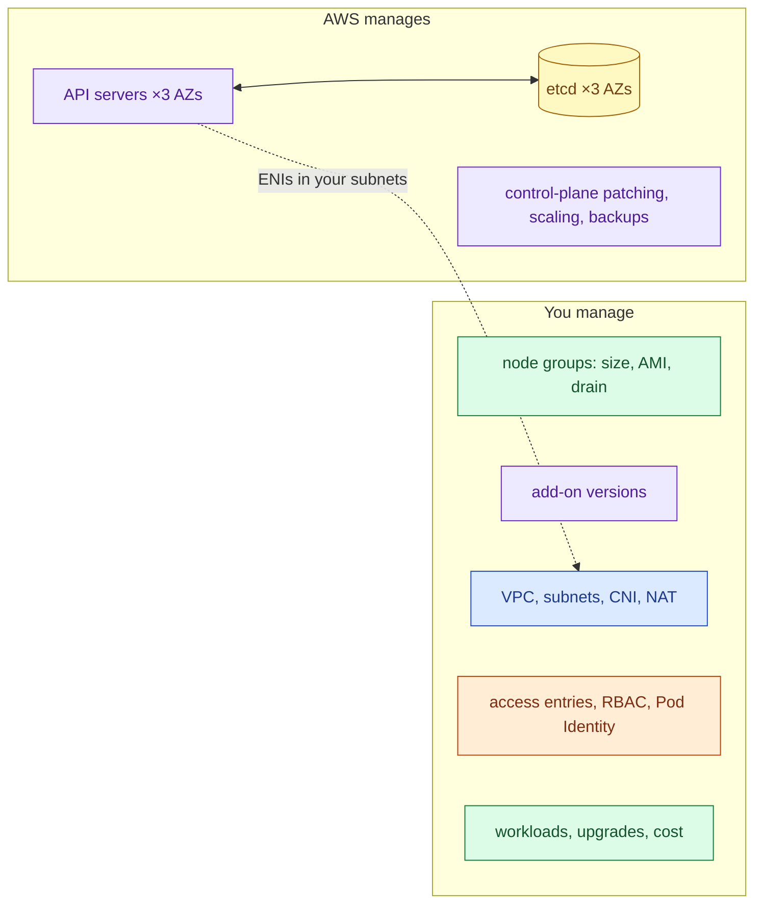
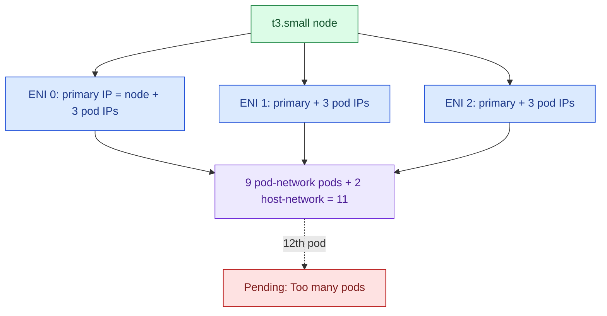
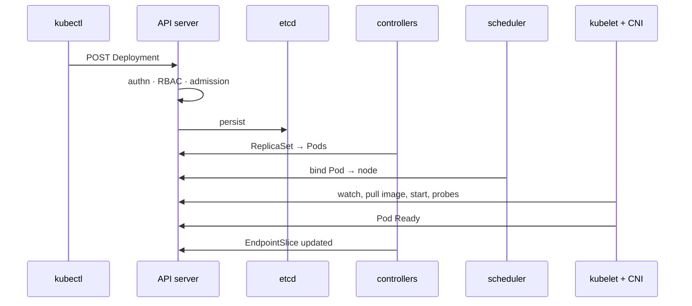
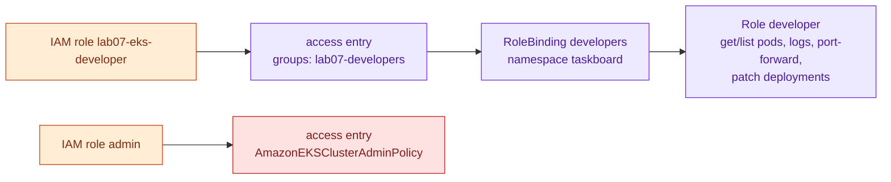
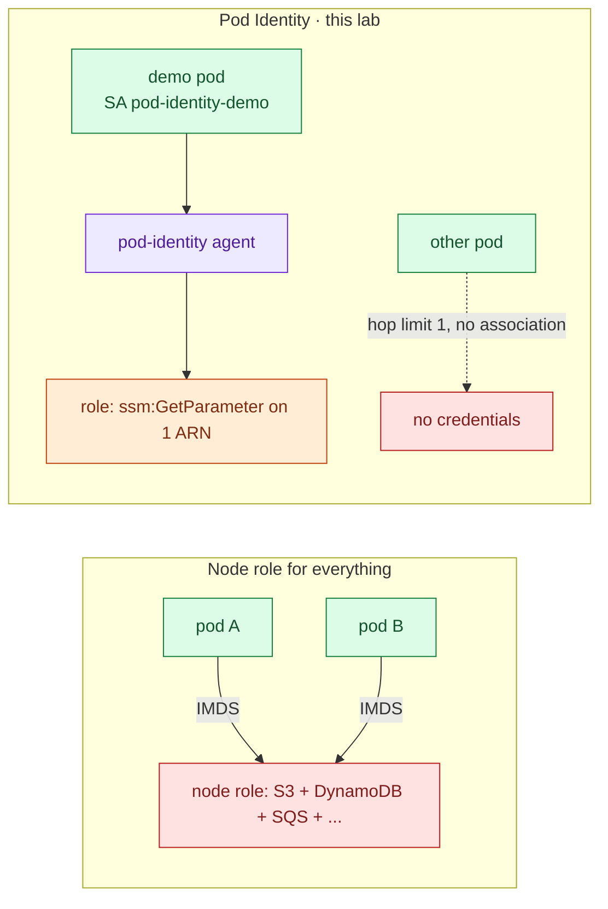
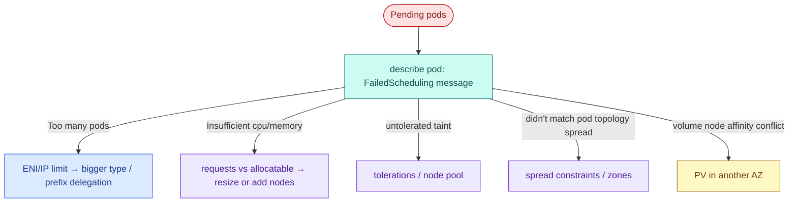
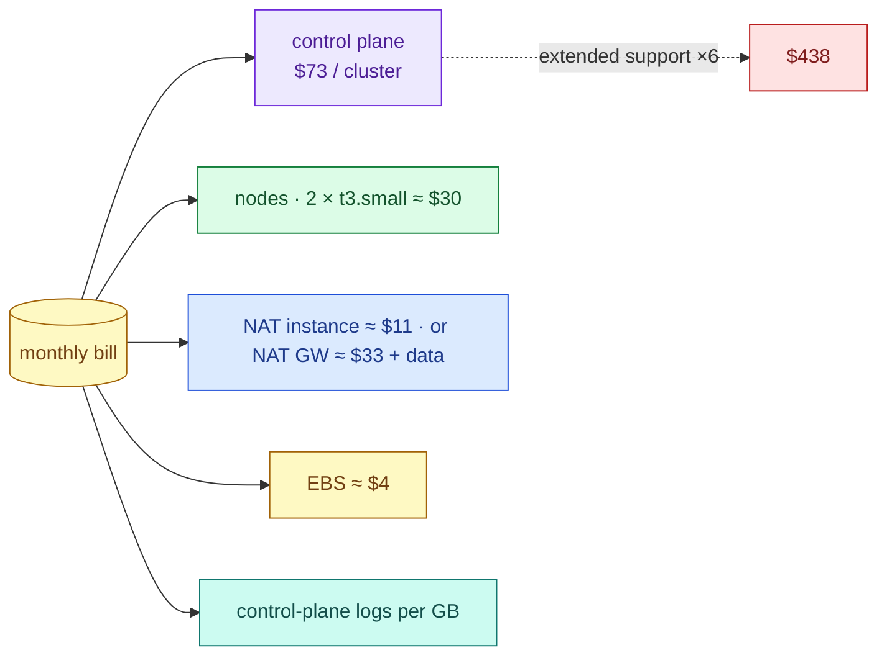

# AWS 07 — Interview preparation

Index of all questions: [interview index](../../../../docs/interview-preparation/README.md).

---

## Q1 (Beginner) — What does EKS manage for you, and what do you still own?

**Interview answer:** EKS runs the control plane: the API servers and etcd across three AZs, their
scaling, patching, backups and availability (with an SLA). You still own the data plane and everything on
it: node groups (sizing, AMI updates, draining), add-on versions, networking (VPC, subnets, CNI
configuration), IAM and RBAC, workloads, upgrades of the Kubernetes version within the support window,
and cost.

**Walkthrough:** the only part of the control plane in your account is its ENIs in your private subnets —
that is how it reaches kubelets.

**Depth:** managed node groups add lifecycle automation (rolling AMI updates, draining); Fargate and EKS
Auto Mode move even more of the data plane to AWS, at different prices and with restrictions.

**Follow-ups:** What does an EKS version upgrade involve, in order? What changes with Auto Mode?

---

## Q2 (Intermediate) — How do pods get IP addresses on EKS, and why can a t3.small only run 11 pods?

**Interview answer:** The Amazon VPC CNI gives each pod a real VPC IP: the `aws-node` DaemonSet attaches
secondary ENIs to the node and assigns their secondary IPs to pods, so pods are first-class VPC citizens
reachable without overlays. The limit follows from the instance's ENI and IP-per-ENI limits: t3.small
supports 3 ENIs with 4 IPs each, minus each ENI's primary IP, plus 2 for host-network pods: 3 × 3 + 2 = 11.

**Walkthrough:** exercise 2 scales to 12 replicas and shows the `Pending` pods.

**Tradeoffs:** prefix delegation assigns /28 prefixes per ENI slot (much higher density) but consumes
subnet space in blocks; custom networking puts pods in separate subnets; overlay CNIs avoid VPC IP use but
lose direct VPC routing.

**Follow-ups:** How would you size subnets for 50 nodes? What breaks when a subnet runs out of IPs?

---

## Q3 (Intermediate) — Walk through what happens between `kubectl apply -f deployment.yaml` and a Ready pod.

**Interview answer:** kubectl sends the object to the API server, which authenticates (on EKS via IAM and
access entries), authorises with RBAC, and runs admission (Pod Security, webhooks) before storing it in
etcd. The Deployment controller creates a ReplicaSet, which creates Pods. The scheduler picks a node per
pod by filtering (resources, taints, affinity) and scoring (spread). The node's kubelet sees the binding,
asks the CNI for networking, pulls the image, starts the container and runs probes; once readiness passes,
the endpoint controller adds the pod to the Service.

**Walkthrough:** every component only talks to the API server; the API server is the only one talking to
etcd. That is why a control-plane outage stops changes but not running pods.

**Follow-ups:** What does the scheduler do if no node fits? Where would a mutating webhook run?

---

## Q4 (Advanced) — How do you control who can do what in an EKS cluster?

**Interview answer:** Two layers. Authentication maps an IAM principal to a Kubernetes identity through
access entries (or the legacy aws-auth ConfigMap). Authorisation is RBAC — Roles and ClusterRoles bound to
users or groups — optionally plus EKS access policies on the entry. I give people IAM roles, map each role
to a Kubernetes group, and grant groups namespaced Roles; cluster-admin only for a small break-glass role.

**Walkthrough:** `verify.sh` asserts the developer can list pods in `taskboard` but cannot delete
deployments, read `kube-system` or list nodes.

**Security concerns:** RBAC on `secrets`, `pods/exec` and `serviceaccounts/token` is effectively credential
access; `escalate`/`bind` verbs allow privilege escalation; the access-entry API itself must be locked
down in IAM.

**Follow-ups:** Why move from aws-auth to access entries? How do you audit who did what (control-plane
audit logs)?

---

## Q5 (Advanced) — How should a pod get AWS permissions, and what is wrong with using the node role?

**Interview answer:** Give the pod its own IAM role through EKS Pod Identity (or IRSA): an association maps
a namespace and ServiceAccount to a role; the pod-identity agent on the node exchanges the pod's token for
role credentials. With the node role, every pod on that node shares one set of permissions — the union of
what all of them need — and any compromised pod can use them via IMDS.

**Walkthrough:** the lab sets the node's IMDS hop limit to 1 so pods cannot fall back to the node role;
exercise 7 proves it with a pod that has no association.

**Tradeoffs:** Pod Identity needs no OIDC provider per cluster and reuses roles across clusters; IRSA works
on non-EKS clusters and older setups. The VPC CNI itself still uses the node role here (ADR-0003).

**Follow-ups:** How do the SDKs find the credentials? How do you limit which namespaces can use a role?

---

## Q6 (Scenario) — Pods are stuck in `Pending` after a deployment scaled up. Diagnose it.

**Interview answer:** `kubectl describe pod` and read the `FailedScheduling` event — it says why each node
was rejected: insufficient CPU or memory against requests, too many pods, taints, affinity or spread
constraints, or volume zone conflicts. Then check node allocatable vs requested, and whether the
autoscaler (if any) is reacting. Fix by right-sizing requests, adding capacity, or relaxing a constraint —
not by removing requests.

**Commands:** `kubectl describe pod`, `kubectl describe nodes | grep -A8 "Allocated resources"`,
`kubectl get events --field-selector reason=FailedScheduling`.

**Follow-ups:** Cluster Autoscaler vs Karpenter? Why are requests, not limits, what the scheduler uses?

---

## Q7 (Scenario) — Your manager asks why the Kubernetes bill is higher than the old VMs. Break it down and cut it.

**Interview answer:** EKS cost = control plane per cluster-hour ($0.10 standard, $0.60 in extended
support) + nodes + EBS + NAT + load balancers + data transfer + logs. For small workloads the fixed control
plane and NAT dominate. Levers: fewer, shared clusters; standard support only (upgrade on time); right-size
requests so nodes pack well; Spot or Graviton nodes; endpoints instead of NAT traffic; destroy dev clusters
nightly.

**Walkthrough:** in this lab the control plane is over 60% of the bill — the reason the README says "plan
a session, then destroy" and the Terraform pins `upgrade_policy = STANDARD`.

**Follow-ups:** When is ECS on Fargate cheaper? How would you attribute cluster cost to teams (requests ×
time, Kubecost/OpenCost)?
