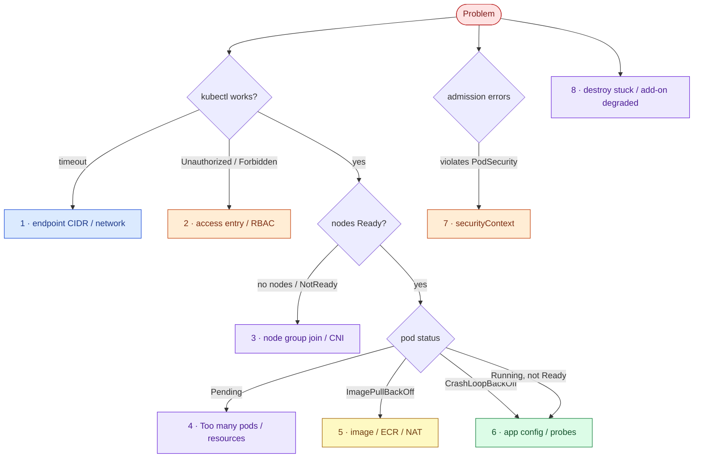

# AWS 07 — Troubleshooting playbook

Debug top-down: can you reach the API → are you authorised → are nodes healthy → can pods be scheduled →
can they start → are they ready.



## 1. `kubectl` times out (`dial tcp ... i/o timeout`)

**Symptoms:** every kubectl command hangs.

**Likely causes:** your public IP is not in `allowed_api_cidrs`; kubeconfig points at an old cluster
endpoint (cluster recreated); corporate proxy.

**Diagnose:**

```bash
curl -s https://checkip.amazonaws.com
aws eks describe-cluster --name lab07-eks --query 'cluster.[resourcesVpcConfig.publicAccessCidrs,endpoint]'
kubectl config view --minify --output jsonpath='{.clusters[0].cluster.server}'
```

**Resolve:** update `allowed_api_cidrs` and apply; re-run the `kubeconfig_command` output.

**Prevent:** for a team, private-only endpoints reached via VPN or a bastion.

## 2. `error: You must be logged in to the server (Unauthorized)` or `Forbidden`

**Symptoms:** authentication fails, or a specific action is forbidden.

**Likely causes:** Unauthorized → no access entry for the IAM principal you are using (wrong profile,
or the entry holds a *session* ARN instead of the role ARN); Forbidden → the entry exists but RBAC or the
access policy does not allow the action.

**Diagnose:**

```bash
aws sts get-caller-identity
aws eks list-access-entries --cluster-name lab07-eks
kubectl auth whoami
kubectl auth can-i --list -n taskboard
```

**What the results mean:** compare the role ARN from `get-caller-identity` (strip the session part) with
the access entries; `whoami` shows the groups the API server sees.

**Resolve:** set `admin_principal_arn` correctly and apply; fix the RoleBinding group name.

**Prevent:** keep `bootstrap_cluster_creator_admin_permissions = false` but always create an explicit
admin entry in the same Terraform (as here) so the cluster is never ownerless.

## 3. Node group fails to create, or nodes stay `NotReady`

**Symptoms:** `NodeCreationFailure` / `Instances failed to join the kubernetes cluster`, or nodes
`NotReady` with `NetworkPluginNotReady`.

**Likely causes:** nodes cannot reach the API or ECR (NAT instance not ready, NACL changed); node role
missing a policy; `vpc-cni` add-on degraded; subnet out of IPs.

**Diagnose:**

```bash
aws eks describe-nodegroup --cluster-name lab07-eks --nodegroup-name default --query 'nodegroup.health'
kubectl describe node <node> | sed -n '/Conditions/,/Addresses/p'
kubectl logs -n kube-system -l k8s-app=aws-node --tail 30
aws ec2 describe-subnets --subnet-ids <private-subnet> --query 'Subnets[0].AvailableIpAddressCount'
```

**Resolve:** fix egress (check the NAT instance per AWS 04 playbook #6), restore IAM attachments, update
the add-on; replace nodes by changing the node group's scaling config.

**Prevent:** add-on ordering in Terraform (networking add-ons before nodes) and `verify.sh` after apply.

## 4. Pods `Pending`: `Too many pods` or `Insufficient cpu/memory`

**Symptoms:** pods never start; Events show `FailedScheduling`.

**Likely causes:** the per-node pod limit (11 on t3.small) is reached; requests exceed allocatable
capacity; topology spread or affinity cannot be satisfied.

**Diagnose:**

```bash
kubectl describe pod -n taskboard <pod> | sed -n '/Events/,$p'
kubectl describe nodes | grep -E 'Allocatable|pods:|cpu:|memory:' | head -20
kubectl get pods -A --field-selector spec.nodeName=<node> | wc -l
```

**Resolve:** scale the node group (`node_count`), use a larger type, lower requests, or enable VPC CNI
prefix delegation.

**Prevent:** capacity planning per node type; Cluster Autoscaler or Karpenter (later labs).

## 5. `ImagePullBackOff` / `ErrImagePull`

**Symptoms:** pods stuck pulling the image.

**Likely causes:** the digest does not exist (AWS 06 repository destroyed or lifecycle-expired); the node
role lacks `AmazonEC2ContainerRegistryPullOnly`; no egress (NAT down) for public images such as the
aws-cli demo; architecture mismatch (arm64 image on x86 nodes).

**Diagnose:**

```bash
kubectl describe pod -n taskboard <pod> | grep -A5 -E 'Failed|Back-off'
aws ecr describe-images --repository-name lab06/taskboard-api --image-ids imageDigest=<digest>
aws iam list-attached-role-policies --role-name lab07-eks-node
```

**Resolve:** redeploy with a digest that exists; restore the policy; fix NAT.

**Prevent:** deploy what the pipeline just released (digest from AWS 06), keep the lifecycle policy's
retention above the number of images you might roll back to.

## 6. `CrashLoopBackOff` or Running but never Ready

**Symptoms:** restart count climbs, or `READY 0/1`.

**Likely causes:** configuration error (`DATABASE_URL`), read-only root filesystem without a writable
mount where the app writes, readiness failing.

**Diagnose:**

```bash
kubectl logs -n taskboard <pod> --previous
kubectl describe pod -n taskboard <pod> | grep -E 'Liveness|Readiness|Last State|Reason|Exit Code'
kubectl exec -n taskboard <pod> -- python -c "import urllib.request; print(urllib.request.urlopen('http://127.0.0.1:8000/readyz').read())"
```

**What the results mean:** exit code 1 with a traceback → config; `Liveness probe failed` → the process
hangs or the probe is too aggressive; `Readiness probe failed` only → dependency.

**Resolve:** `kubectl rollout undo`; fix ConfigMap values.

**Prevent:** readiness gates rollouts, so a bad config stops at the first new pod (exercise 5).

## 7. `violates PodSecurity "restricted:latest"`

**Symptoms:** `Error from server (Forbidden): pods "x" is forbidden: violates PodSecurity`.

**Likely causes:** the pod spec lacks `runAsNonRoot`, `allowPrivilegeEscalation: false`, dropped
capabilities or a seccomp profile; image runs as root by default.

**Diagnose:** the error message lists every violated field. Compare with
[taskboard.yaml](../k8s/base/taskboard.yaml).

**Resolve:** add the security context fields; use a non-root image.

**Prevent:** this is the control working — do not relax the namespace label to make a workload fit.

## 8. `terraform destroy` hangs, or an add-on is `DEGRADED`

**Symptoms:** destroy waits on the node group or VPC; `describe-addon` shows `DEGRADED` with health
issues.

**Likely causes:** Kubernetes created AWS resources Terraform does not know (load balancers from a
`Service type=LoadBalancer` someone applied, ENIs still attached); add-on conflicts with
manually edited manifests; CoreDNS without nodes.

**Diagnose:**

```bash
aws elbv2 describe-load-balancers --query 'LoadBalancers[?VpcId==`<vpc>`].LoadBalancerName'
aws ec2 describe-network-interfaces --filters Name=vpc-id,Values=<vpc> --query 'NetworkInterfaces[].[NetworkInterfaceId,Description,Status]'
aws eks describe-addon --cluster-name lab07-eks --addon-name coredns --query 'addon.health'
```

**Resolve:** delete Kubernetes objects that create AWS resources first (`kubectl delete ns taskboard`),
then destroy; re-apply the add-on with `OVERWRITE`.

**Prevent:** the README's cleanup order; never hand-edit add-on-managed objects.
