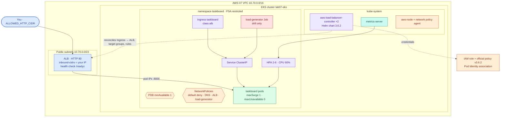
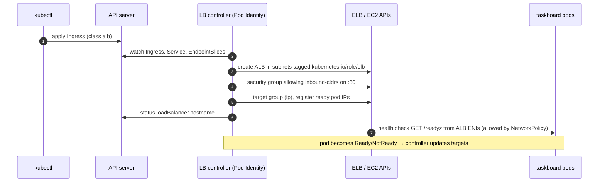
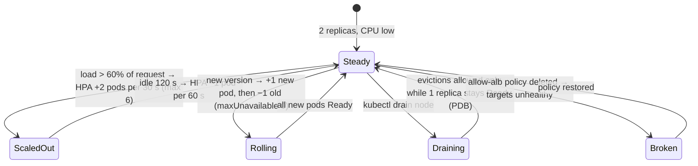

# AWS 08 — Kubernetes Networking and Autoscaling

| | |
|---|---|
| **Project ID** | `aws-08` |
| **Cloud** | AWS (EKS from AWS 07, AWS Load Balancer Controller, Application Load Balancer, IAM, Pod Identity) |
| **Difficulty** | Intermediate |
| **Build time** | 3–4 h first attempt (on a running AWS 07 cluster) |
| **Rebuild time** | 15 min (plus AWS 07) |
| **Free tier** | **No**: runs on the billed AWS 07 cluster and adds an ALB — see [cost](docs/cost.md) (≈ +$0.12 per 3-hour session) |
| **Depends on** | [AWS 07](../07-managed-kubernetes-foundations/) (cluster with `enable_network_policy = true`), [AWS 06](../06-secure-cicd-container-registry/) (image) |
| **Status** | Implemented · static checks passed (Terraform, manifests vs Kubernetes 1.37 schemas) · deployment **not tested** ([tracker](../../../docs/progress/implementation-tracker.md)) |

## The problem this lab solves

At the end of AWS 07 the app ran on Kubernetes but only you could reach it, through `kubectl
port-forward`. Every pod could talk to every other pod in the cluster, two replicas were fixed whatever the
load, and nothing stopped a node drain from taking both replicas at once.

This lab turns the Deployment into a service: an **Ingress** that the AWS Load Balancer Controller turns
into an ALB sending traffic straight to pod IPs; a **default-deny NetworkPolicy** model with explicit
allows; a **HorizontalPodAutoscaler** driven by metrics-server; a **PodDisruptionBudget**; and a rolling
update strategy that never reduces capacity. Then you load it, drain nodes, roll it out and break a policy
while watching what users see.

**Skills learned:** Service vs Ingress vs LoadBalancer · AWS Load Balancer Controller, IngressClass,
annotations, `ip` vs `instance` targets · controller IAM via Pod Identity · NetworkPolicy semantics and
default deny · HPA algorithm, requests and stabilisation · PDBs and drains · `maxSurge`/`maxUnavailable` ·
kustomize overlays and patches · orphaned cloud resources created by Kubernetes.

**Expected outcome:** `scripts/verify.sh` passes — controller ready with Pod Identity credentials, the ALB
answering from your IP and spreading over pods, HPA reading CPU, PDB in force, `maxUnavailable: 0`, and
NetworkPolicy allowing exactly the load-generator and ALB flows while denying others.

## Architecture



| Component | Why it is there | Defined in |
|---|---|---|
| IAM role + policy + Pod Identity association | Controller manages ALBs with its own credentials, not the node role | [main.tf](terraform/main.tf), [policy v3.6.2](terraform/policies/aws-load-balancer-controller-v3.6.2.json) |
| AWS Load Balancer Controller | Turns Ingress objects into ALBs, listeners, target groups | [install-controller.sh](scripts/install-controller.sh) |
| Ingress | `internet-facing`, `target-type: ip`, `/readyz` health check, your CIDR only, repository tags | [ingress.yaml](k8s/ingress.yaml) |
| HPA | 2–6 replicas at 60% of the CPU request; fast scale-up, slow scale-down | [hpa.yaml](k8s/hpa.yaml) |
| PDB | Drains keep at least one ready replica | [pdb.yaml](k8s/pdb.yaml) |
| NetworkPolicies | Default deny in/out; DNS, ALB subnets and load-generator explicitly allowed | [networkpolicy.yaml](k8s/networkpolicy.yaml) |
| Kustomization | Reuses AWS 07's base; removes `replicas`, adds the surge strategy | [kustomization.yaml](k8s/kustomization.yaml) |
| Network policy agent | VPC CNI enforcement switched on in AWS 07 (`enable_network_policy`) | [AWS 07 addons.tf](../07-managed-kubernetes-foundations/terraform/addons.tf) |

### From `kubectl apply` to a working ALB



### Load, rollout and drain



## Concepts used

| Concept | Where in this lab | Guide |
|---|---|---|
| Services, Ingress, NetworkPolicy, HPA, PDB, rollouts | All manifests | [kubernetes-traffic-and-scaling](../../../docs/concepts/kubernetes-traffic-and-scaling.md) |
| Pod Identity, RBAC | Controller credentials | [eks-access-and-identity](../../../docs/concepts/eks-access-and-identity.md) |
| Readiness vs liveness | ALB health check `/readyz` | [health-checks](../../../docs/concepts/health-checks.md) |
| Load balancing, autoscaling (EC2 view) | Comparison with AWS 05 | [load-balancing-and-autoscaling](../../../docs/concepts/load-balancing-and-autoscaling.md) |
| VPC subnets and tags | ALB placement | [aws-vpc-design](../../../docs/concepts/aws-vpc-design.md) |

Architecture decisions: [ADR-0001 ALB Ingress with IP targets](docs/adr/0001-alb-ingress-ip-targets.md) ·
[ADR-0002 HPA on CPU with PDB and surge rollouts](docs/adr/0002-hpa-cpu-pdb-surge.md) ·
[ADR-0003 default-deny NetworkPolicy with the VPC CNI](docs/adr/0003-default-deny-networkpolicy-vpc-cni.md).

## Deploy

> Runs on the AWS 07 cluster, which is billed per hour. Do AWS 07 and 08 in one session.

### 1. Prerequisites

```bash
cd projects/aws/08-kubernetes-networking-autoscaling
kubectl config current-context                     # lab07-admin
aws eks describe-addon --cluster-name lab07-eks --addon-name vpc-cni --query addon.configurationValues
#   -> {"enableNetworkPolicy":"true"}   (AWS 07 default; re-apply AWS 07 if missing)
helm version                                       # v3.14+ or v4
```

### 2. Controller IAM and installation

```bash
cp terraform/terraform.tfvars.example terraform/terraform.tfvars
../../../shared/scripts/tf-init-backend.sh terraform
terraform -chdir=terraform plan -out=lab08.tfplan   # 4 resources
terraform -chdir=terraform apply lab08.tfplan
scripts/install-controller.sh
```

### 3. Deploy and verify

```bash
scripts/deploy-workloads.sh                 # your current public IP becomes the ALB's allowed CIDR
scripts/verify.sh
```

| Check | Expected |
|---|---|
| Controller | ≥ 1 ready replica; `AWS_CONTAINER_CREDENTIALS_FULL_URI` in its env (Pod Identity) |
| Ingress | ALB hostname; `/readyz` answers from your IP; ≥ 2 pods seen; ≥ 2 healthy targets |
| HPA | current CPU utilisation reported |
| Rollout strategy | `maxUnavailable: 0` |
| PDB | ≥ 1 disruption allowed |
| NetworkPolicy | load-generator → taskboard allowed; unlabelled pod and other namespace denied |

### 4. Exercises and drills

[docs/exercises.md](docs/exercises.md) and `scripts/failure-drill.sh list` (load, drain, rollout,
break-policy, restore-policy).

### 5. Clean up — order matters

```bash
kubectl delete -k k8s/.generated                    # deletes the Ingress → the controller deletes the ALB
aws elbv2 describe-load-balancers --query 'LoadBalancers[?starts_with(LoadBalancerName,`k8s-taskboar`)].LoadBalancerName'   # wait until empty
helm uninstall aws-load-balancer-controller -n kube-system
terraform -chdir=terraform destroy
# then AWS 07's cleanup
```

If you destroy the cluster first, the ALB, its security groups and target groups are orphaned and keep
billing; `aws-find-lab-resources.sh` finds them by the tags set in the Ingress.

## Troubleshooting, cost and interview material

- [Troubleshooting playbook](docs/troubleshooting.md) — 7 incidents
- [Cost estimate](docs/cost.md)
- [Interview preparation](docs/interview.md) — 7 questions

## Repeat practice

| Attempt | Goal | Guidance |
|---|---|---|
| 1 | Guided build | Follow this README and the exercises |
| 2 | Reduced guidance | Predict the replica count, PDB status and probe results before each drill |
| 3 | Rebuild from objectives | Write the NetworkPolicies yourself from the "who may talk to whom" list; pass `verify.sh` |
| 4 | Failure drills | Someone runs a drill or deletes one policy without telling you; find it from symptoms |
| 5 | Defend the design | Answer the [interview questions](docs/interview.md); argue `instance` targets or NLB and lose |

### Self-assessment

- [ ] I can explain the path of a request from my laptop to a pod, naming every component.
- [ ] I can explain why the Deployment must not set `replicas` when an HPA exists.
- [ ] I can compute what the HPA will do from current CPU and requests.
- [ ] I can explain why the ALB needs its own NetworkPolicy allow, and from which CIDR.
- [ ] I drained a node and can explain what the PDB did.
- [ ] I can list the AWS resources the controller created that Terraform does not know about.

**Done when:** `verify.sh` passes, all drills ran, the self-assessment is complete, and cleanup left no
`k8s-taskboar*` load balancers or tagged resources.

## References

- [AWS Load Balancer Controller documentation](https://kubernetes-sigs.github.io/aws-load-balancer-controller/latest/)
- [EKS network policies](https://docs.aws.amazon.com/eks/latest/userguide/cni-network-policy.html)
- [Kubernetes HPA walkthrough](https://kubernetes.io/docs/tasks/run-application/horizontal-pod-autoscale-walkthrough/)
- [EKS Best Practices — Networking](https://docs.aws.amazon.com/eks/latest/best-practices/networking.html)
