# AWS 08 — Hands-on exercises

Run after `scripts/deploy-workloads.sh`. Keep a probe running in a second terminal for exercises 3–6:

```bash
NS="-n taskboard"
ALB=$(kubectl get ingress $NS taskboard -o jsonpath='{.status.loadBalancer.ingress[0].hostname}')
while true; do printf '%s %s\n' "$(date +%T)" "$(curl -s -o /dev/null -m 3 -w '%{http_code}' http://$ALB/api/info)"; sleep 0.5; done
```



```mermaid
flowchart LR
    e1[1 Trace a request]:::net --> e2[2 ip vs instance targets]:::net --> e3[3 Autoscaling]:::k8s
    e3 --> e4[4 Rolling update]:::app --> e5[5 Drain + PDB]:::risk --> e6[6 NetworkPolicy]:::sec --> e7[7 Orphaned ALB]:::risk
    classDef net fill:#dbeafe,stroke:#1d4ed8,color:#1e3a8a
    classDef k8s fill:#ede9fe,stroke:#6d28d9,color:#4c1d95
    classDef app fill:#dcfce7,stroke:#15803d,color:#14532d
    classDef risk fill:#fee2e2,stroke:#b91c1c,color:#7f1d1d
    classDef sec fill:#ffedd5,stroke:#c2410c,color:#7c2d12
```

## 1. Trace one request end to end

```bash
dig +short $ALB
kubectl describe ingress $NS taskboard | sed -n '/Rules/,/Events/p'
aws elbv2 describe-load-balancers --query "LoadBalancers[?DNSName=='$ALB'].[LoadBalancerArn,Scheme,AvailabilityZones[].ZoneName]"
TG=$(aws elbv2 describe-target-groups --query "TargetGroups[?starts_with(TargetGroupName,'k8s-taskboar')].TargetGroupArn" --output text)
aws elbv2 describe-target-health --target-group-arn $TG --query 'TargetHealthDescriptions[].[Target.Id,Target.Port,TargetHealth.State]' --output table
kubectl get pods $NS -o wide
```

**Expected:** target IDs are pod IPs (port 8000), matching `kubectl get pods -o wide`. Write the path:
DNS → ALB node in a public subnet → ALB security group (your CIDR) → pod IP across the VPC → NetworkPolicy
`allow-alb-to-taskboard` → container. Name where kube-proxy is *not* involved.

## 2. `ip` vs `instance` targets

```bash
kubectl annotate ingress $NS taskboard alb.ingress.kubernetes.io/target-type=instance --overwrite
kubectl describe ingress $NS taskboard | tail -n 5
kubectl annotate ingress $NS taskboard alb.ingress.kubernetes.io/target-type=ip --overwrite
```

**Expected:** with `instance`, the controller reports that the Service must be `NodePort` (it is
ClusterIP) and stops reconciling — an instructive error. Explain the extra hop, lost client IP, and slower
deregistration of `instance` mode, and why the VPC CNI makes `ip` possible.

## 3. Autoscaling

```bash
scripts/failure-drill.sh load
kubectl get hpa $NS taskboard -w            # watch TARGETS and REPLICAS
kubectl describe hpa $NS taskboard | sed -n '/Conditions/,$p'
kubectl top pods $NS
```

**Expected:** utilisation climbs above 60% within a minute or two; replicas go 2 → 4 → 6 (two at a time
per 30 s); after the Job ends (10 min) and 120 s of low load, one pod is removed per minute. If new pods
stay `Pending` (`Too many pods` on t3.small), you have hit node capacity — the HPA scales pods, not nodes.
Compute the expected replicas from the formula `ceil(replicas × current% / 60%)` for one sample.

## 4. Rolling update without errors

```bash
scripts/failure-drill.sh rollout
kubectl get rs $NS -w
```

**Expected:** the probe keeps printing `200`. One new pod becomes Ready before an old one terminates.
Repeat after `kubectl patch deploy $NS taskboard -p '{"spec":{"strategy":{"rollingUpdate":{"maxUnavailable":1,"maxSurge":0}}}}'`
and note any errors; restore with `scripts/failure-drill.sh restore-policy` (re-applies everything).

## 5. Drain a node with a PDB

```bash
kubectl get pdb $NS taskboard
scripts/failure-drill.sh drain
kubectl get pods $NS -o wide -w
kubectl uncordon <node>
```

**Expected:** eviction of the second replica waits until the first replacement is Ready ("Cannot evict
pod as it would violate the pod's disruption budget" may appear and be retried). The probe stays green.
Then set `minAvailable: 2` with 2 replicas and try again — the drain blocks until the timeout. Explain why
that PDB is a maintenance outage waiting to happen.

## 6. NetworkPolicy

```bash
kubectl get networkpolicy $NS
scripts/failure-drill.sh break-policy        # removes allow-alb-to-taskboard
watch -n 5 "aws elbv2 describe-target-health --target-group-arn $TG --query 'TargetHealthDescriptions[].TargetHealth.State' --output text"
scripts/failure-drill.sh restore-policy
kubectl run curl-test $NS --rm -i --restart=Never --image=busybox:1.37 \
  --overrides='{"spec":{"securityContext":{"runAsNonRoot":true,"runAsUser":65534,"seccompProfile":{"type":"RuntimeDefault"}},"containers":[{"name":"c","image":"busybox:1.37","command":["wget","-T","5","-qO-","http://taskboard/healthz"],"securityContext":{"allowPrivilegeEscalation":false,"capabilities":{"drop":["ALL"]}}}]}}'
```

**Expected:** without the ALB allow, health checks time out, targets turn `unhealthy`, and the probe shows
502/503. The test pod times out too (no label that any allow policy matches; also no egress allow). Write
the minimum policy that would let a new `reporting` pod read `/api/tasks`, then apply and test it.

## 7. Resources Kubernetes created behind Terraform's back

```bash
aws elbv2 describe-load-balancers --query 'LoadBalancers[?starts_with(LoadBalancerName,`k8s-`)].[LoadBalancerName,VpcId]' --output table
aws ec2 describe-security-groups --filters Name=tag:elbv2.k8s.aws/cluster,Values=lab07-eks --query 'SecurityGroups[].[GroupId,GroupName]' --output table
../../../shared/scripts/aws-find-lab-resources.sh
```

**Expected:** the ALB, its target group and two security groups exist but appear in no Terraform state.
They carry the Ingress's `Repository`/`Project` tags, so the cleanup finder lists them. Explain the safe
teardown order (delete the Ingress, wait for the ALB to disappear, then destroy infrastructure) and what
happens otherwise.
