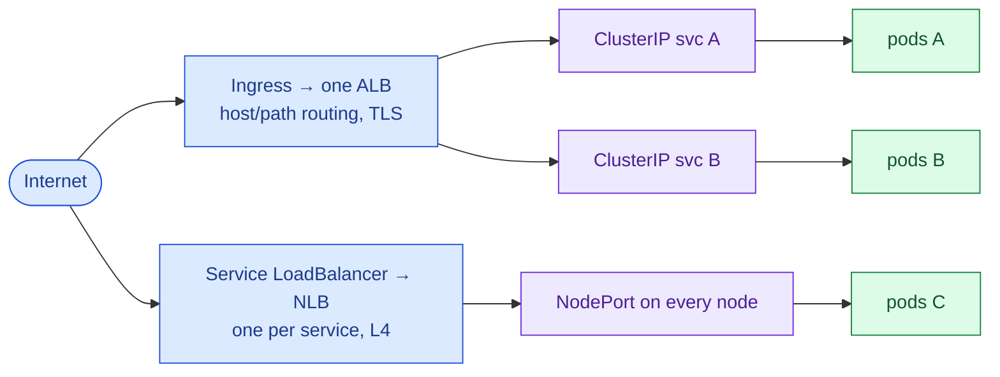
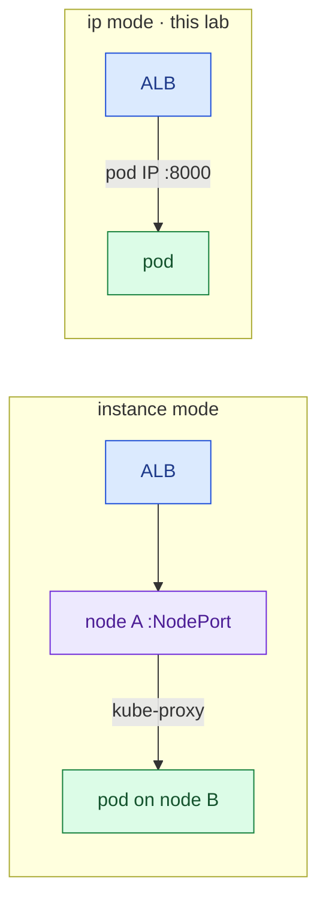
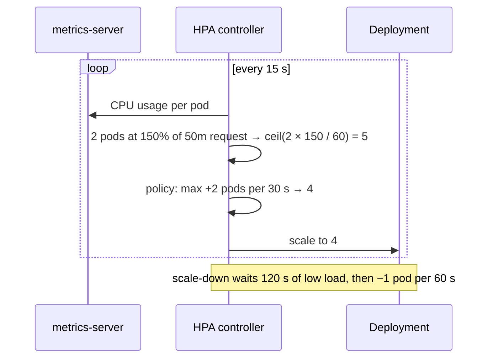
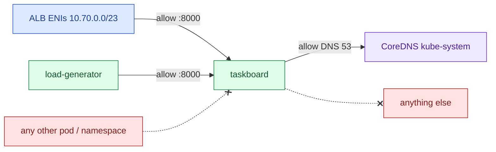
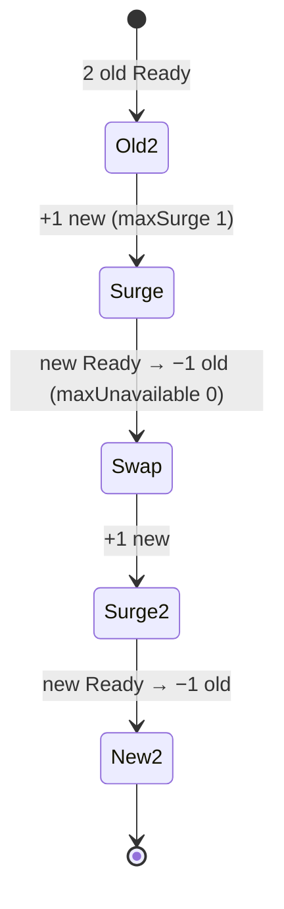
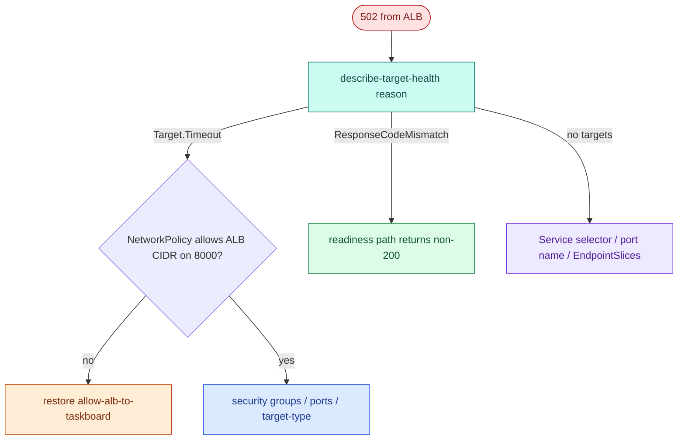
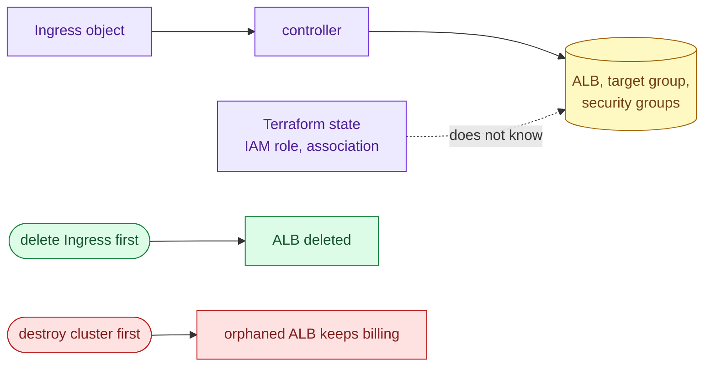

# AWS 08 — Interview preparation

Index of all questions: [interview index](../../../../docs/interview-preparation/README.md).

---

## Q1 (Beginner) — ClusterIP, NodePort, LoadBalancer, Ingress: when do you use each?

**Interview answer:** ClusterIP gives pods a stable in-cluster address — the default for service-to-service
traffic. NodePort opens the same port on every node, mostly as a building block. LoadBalancer asks the
cloud for an L4 load balancer per Service. Ingress is L7 routing (host and path rules, TLS) through one
controller-managed load balancer for many Services — what most HTTP apps use.

**Walkthrough:** this lab uses a ClusterIP Service behind an Ingress; with `target-type: ip` the ALB even
bypasses the Service's virtual IP and sends to pod IPs directly.

**Follow-ups:** What is the Gateway API and why is it replacing Ingress? When would you choose an NLB?

---

## Q2 (Intermediate) — Explain `target-type: ip` vs `instance` on the AWS Load Balancer Controller.

**Interview answer:** `instance` registers nodes; the ALB sends to a NodePort and kube-proxy forwards to a
pod, possibly on another node — an extra hop, source IP rewritten, and health checks that test nodes
rather than pods. `ip` registers pod IPs directly, which works because the VPC CNI gives pods VPC
addresses: one hop, per-pod health checks, faster draining, and NetworkPolicies that see the ALB's IPs.

**Tradeoffs:** `ip` mode needs routable pod IPs (VPC CNI, not an overlay) and more targets in the target
group; `instance` works with any CNI.

**Follow-ups:** How does the controller keep targets in sync during a rollout (EndpointSlices, readiness
gates)?

---

## Q3 (Intermediate) — How does the HPA decide how many replicas to run?

**Interview answer:** Every 15 seconds it reads the metric (here CPU from metrics-server), computes
utilisation as usage divided by the containers' CPU *requests*, and sets `desired = ceil(current ×
currentUtilisation / target)`, bounded by min/max and by the scale-up and scale-down policies and
stabilisation windows. So requests must be realistic, and scale-down is deliberately slower than scale-up.

**Walkthrough:** exercise 3 lets you compare the formula with what the HPA actually did.

**Follow-ups:** Why not scale on memory for this app? What does KEDA add (event sources, scale to zero)?

---

## Q4 (Advanced) — Design NetworkPolicies for a namespace. What goes wrong most often?

**Interview answer:** Start with default-deny for ingress and egress on all pods in the namespace, then
add narrow allows: DNS egress to CoreDNS, ingress to the app from the load balancer's subnets and from
specific client labels, egress to the dependencies it really calls. Most outages come from forgetting DNS,
forgetting the load balancer's health checks, or assuming policies are evaluated in order (they are
additive — any matching allow permits the flow).

**Walkthrough:** `verify.sh` proves both directions: the allowed label gets through, an unlabelled pod and
a pod in another namespace do not.

**Security concerns:** policies need a CNI that enforces them (the VPC CNI agent must be enabled);
`ipBlock` on pod IPs is brittle; label-based allows trust whoever can create pods with that label.

**Follow-ups:** How do you test policies before enforcing them? What can't NetworkPolicy express (L7, FQDN)?

---

## Q5 (Intermediate) — How do you get zero-downtime deployments and node maintenance on Kubernetes?

**Interview answer:** Readiness probes so traffic only reaches pods that can serve; a rolling strategy that
adds before it removes (`maxSurge ≥ 1`, `maxUnavailable: 0`); load balancers that deregister pods before
they stop (deregistration delay, preStop where needed); at least two replicas spread over nodes and AZs;
and a PodDisruptionBudget so drains and upgrades evict one pod at a time.

**Walkthrough:** the probe in exercise 4 stays at 200 throughout; flipping to `maxUnavailable: 1,
maxSurge: 0` shows the difference.

**Follow-ups:** What does a PDB *not* protect against (node crashes, involuntary disruptions)? Canary
deployments on Kubernetes (Argo Rollouts, AWS 09+)?

---

## Q6 (Scenario) — After a change, the ALB returns 502 for every request but all pods are Running and Ready. Debug it.

**Interview answer:** Running and Ready means the kubelet can reach the pods; the ALB cannot. I check target
health and its reason: timeouts point at the network path — a NetworkPolicy change that dropped the ALB's
CIDR, a security group, or targets in the wrong port. I compare the recent change, look at
`kubectl get networkpolicy`, and test the path from the ALB subnet's perspective.

**Walkthrough:** `failure-drill.sh break-policy` reproduces exactly this.

**Follow-ups:** Why are kubelet probes unaffected by the policy? How would you alert on unhealthy targets
(AWS 11)?

---

## Q7 (Advanced) — Kubernetes created an ALB. Who owns it, and how do you avoid leaks and surprises?

**Interview answer:** The controller owns it, driven by the Ingress object — Terraform does not know it
exists. That means it is created and deleted by Kubernetes lifecycle, costs money while the Ingress exists,
and is orphaned if the cluster disappears first. I tag controller-created resources, delete Ingresses
before tearing down clusters, restrict who may create internet-facing Ingresses (admission policy), and
watch for untracked load balancers in cost reports.

**Walkthrough:** the Ingress here carries `Repository`/`Project` tags so the cleanup finder catches leaks.

**Follow-ups:** How would you share one ALB across many Ingresses (`group.name`)? How do you restrict
internet-facing load balancers to approved namespaces?
