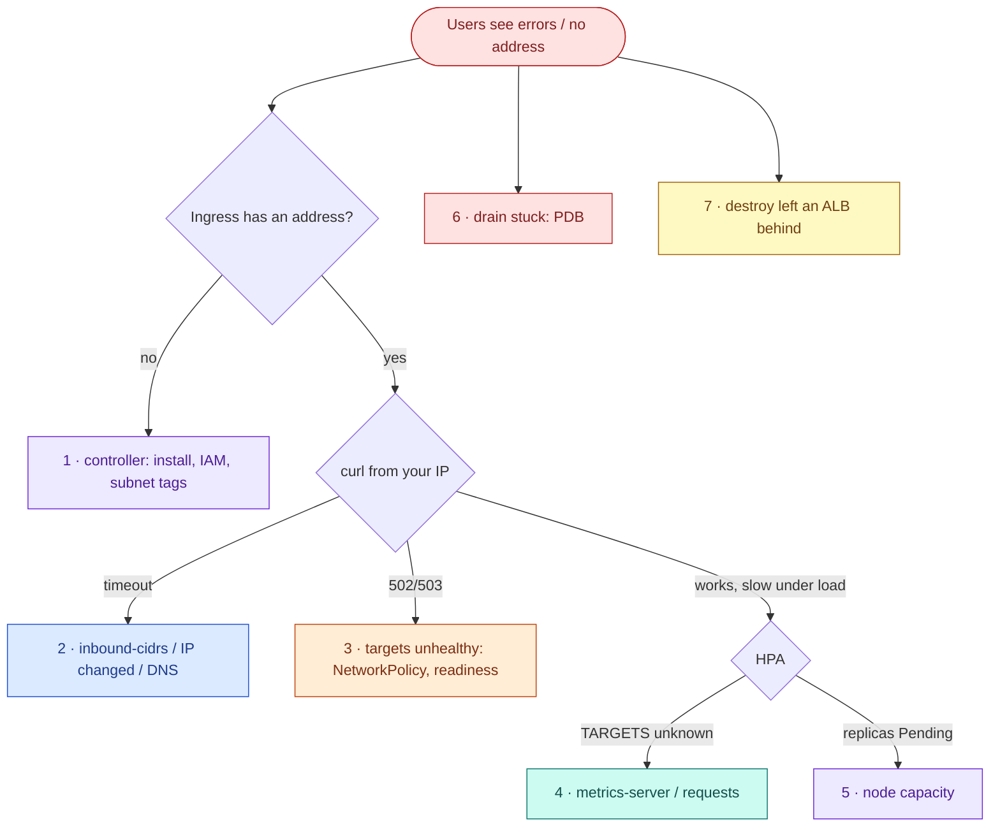

# AWS 08 — Troubleshooting playbook



## 1. Ingress never gets an address

**Symptoms:** `kubectl get ingress` shows an empty ADDRESS for minutes.

**Likely causes:** controller not running; its Pod Identity association missing (AccessDenied in logs);
the service account name differs from the association (`aws-load-balancer-controller` in `kube-system`);
no subnets tagged `kubernetes.io/role/elb`; IngressClass `alb` missing.

**Diagnose:**

```bash
kubectl get pods -n kube-system -l app.kubernetes.io/name=aws-load-balancer-controller
kubectl logs -n kube-system deploy/aws-load-balancer-controller --tail 50 | grep -iE 'error|denied|subnet'
kubectl describe ingress -n taskboard taskboard | sed -n '/Events/,$p'
aws eks list-pod-identity-associations --cluster-name lab07-eks --namespace kube-system
aws ec2 describe-subnets --filters Name=tag:kubernetes.io/role/elb,Values=1 --query 'Subnets[].SubnetId'
```

**What the results mean:** `AccessDenied` → IAM/association; `couldn't auto-discover subnets` → tags;
no events at all → controller not watching (not installed, or wrong `ingressClassName`).

**Resolve:** `terraform apply` (association), re-run `install-controller.sh`, fix tags in AWS 07.

**Prevent:** install the controller from the same pipeline as the association; `verify.sh` checks Pod
Identity env on the controller.

## 2. ALB address exists but requests time out

**Symptoms:** `curl http://<alb>/` hangs.

**Likely causes:** your public IP changed and no longer matches `inbound-cidrs`; DNS for a brand-new ALB not
propagated; the ALB is still `provisioning`.

**Diagnose:**

```bash
curl -s https://checkip.amazonaws.com
kubectl get ingress -n taskboard taskboard -o jsonpath='{.metadata.annotations.alb\.ingress\.kubernetes\.io/inbound-cidrs}'
aws elbv2 describe-load-balancers --query "LoadBalancers[?starts_with(LoadBalancerName,'k8s-taskboar')].State"
```

**Resolve:** re-run `scripts/deploy-workloads.sh` (it detects your current IP).

**Prevent:** in production, put the ALB behind a stable entry (CloudFront, WAF) instead of per-IP rules.

## 3. `502 Bad Gateway` / `503 Service Temporarily Unavailable`

**Symptoms:** the ALB answers but with errors; targets `unhealthy` or none registered.

**Likely causes:** NetworkPolicy blocks ALB health checks (allow policy deleted, VPC CIDR changed);
readiness failing; pods restarting; `target-type` switched to `instance` without a NodePort Service.

**Diagnose:**

```bash
aws elbv2 describe-target-health --target-group-arn <tg> --query 'TargetHealthDescriptions[].[Target.Id,TargetHealth.State,TargetHealth.Reason]' --output table
kubectl get networkpolicy -n taskboard
kubectl get pods -n taskboard -o wide
kubectl get endpointslices -n taskboard
```

**What the results mean:** `Target.Timeout` with Ready pods → network path (NetworkPolicy, SG);
`Target.ResponseCodeMismatch` → readiness failing; no targets → no Ready pods or wrong Service port name.

**Resolve:** `scripts/failure-drill.sh restore-policy`; fix the app.

**Prevent:** policy changes go through review; `verify.sh` asserts the ALB path after every deploy.

## 4. HPA shows `<unknown>/60%`

**Symptoms:** TARGETS unknown, no scaling; condition `FailedGetResourceMetric`.

**Likely causes:** metrics-server not ready; pods without CPU requests; HPA pointing at the wrong
Deployment.

**Diagnose:**

```bash
kubectl get apiservice v1beta1.metrics.k8s.io
kubectl top pods -n taskboard
kubectl describe hpa -n taskboard taskboard | sed -n '/Conditions/,$p'
kubectl get deploy -n taskboard taskboard -o jsonpath='{.spec.template.spec.containers[0].resources}'
```

**Resolve:** restore metrics-server (AWS 07 add-on); add requests.

**Prevent:** policy that every container declares requests (admission checks, AWS 09+).

## 5. HPA scales up but new pods stay `Pending`

**Symptoms:** desired replicas 6, ready 4; events `Too many pods` or `Insufficient cpu`.

**Likely causes:** node capacity — t3.small allows 11 pods per node, and system pods, the controller and
load-generator pods share them; no node autoscaling in this lab.

**Diagnose:** `kubectl describe pod <pending>`; `kubectl get pods -A -o wide | awk '{print $8}' | sort | uniq -c`.

**Resolve:** raise AWS 07 `node_count` to 3 or use `c7i-flex.large`; lower `maxReplicas`.

**Prevent:** pair the HPA with a node autoscaler (Cluster Autoscaler or Karpenter) and plan pod density.

## 6. `kubectl drain` hangs on eviction

**Symptoms:** `Cannot evict pod as it would violate the pod's disruption budget`, retried until timeout.

**Likely causes:** only one Ready replica (the other Pending/unhealthy); `minAvailable` ≥ replicas; the
replacement cannot schedule elsewhere.

**Diagnose:**

```bash
kubectl get pdb -n taskboard taskboard -o jsonpath='{.status}' ; echo
kubectl get pods -n taskboard -o wide
```

**Resolve:** fix the unhealthy replica or add capacity; never delete the PDB to force a drain in production
without understanding the impact.

**Prevent:** `minAvailable` < minimum replicas; HPA `minReplicas` ≥ 2.

## 7. Teardown left an ALB (and security groups) behind

**Symptoms:** cleanup finder lists `k8s-taskboar…` load balancers after the cluster is gone; AWS 07's VPC
destroy fails with `DependencyViolation`.

**Likely causes:** the cluster or controller was deleted before the Ingress, so nobody deleted the ALB.

**Diagnose:**

```bash
../../../shared/scripts/aws-find-lab-resources.sh
aws elbv2 describe-load-balancers --query 'LoadBalancers[?starts_with(LoadBalancerName,`k8s-`)].[LoadBalancerArn,VpcId]'
```

**Resolve:** delete the load balancer, then its target groups and the `elbv2.k8s.aws/cluster`-tagged
security groups, then retry the VPC destroy.

**Prevent:** follow the README's cleanup order; tags on every controller-created resource.
