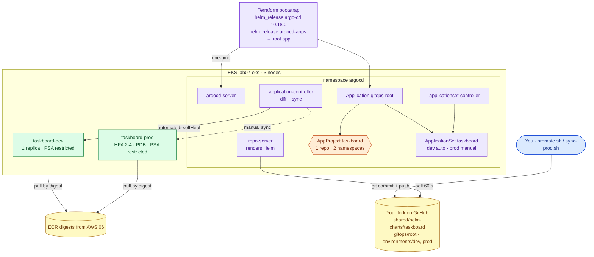
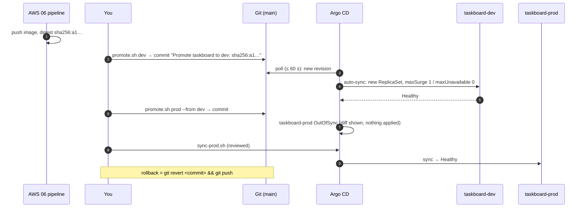
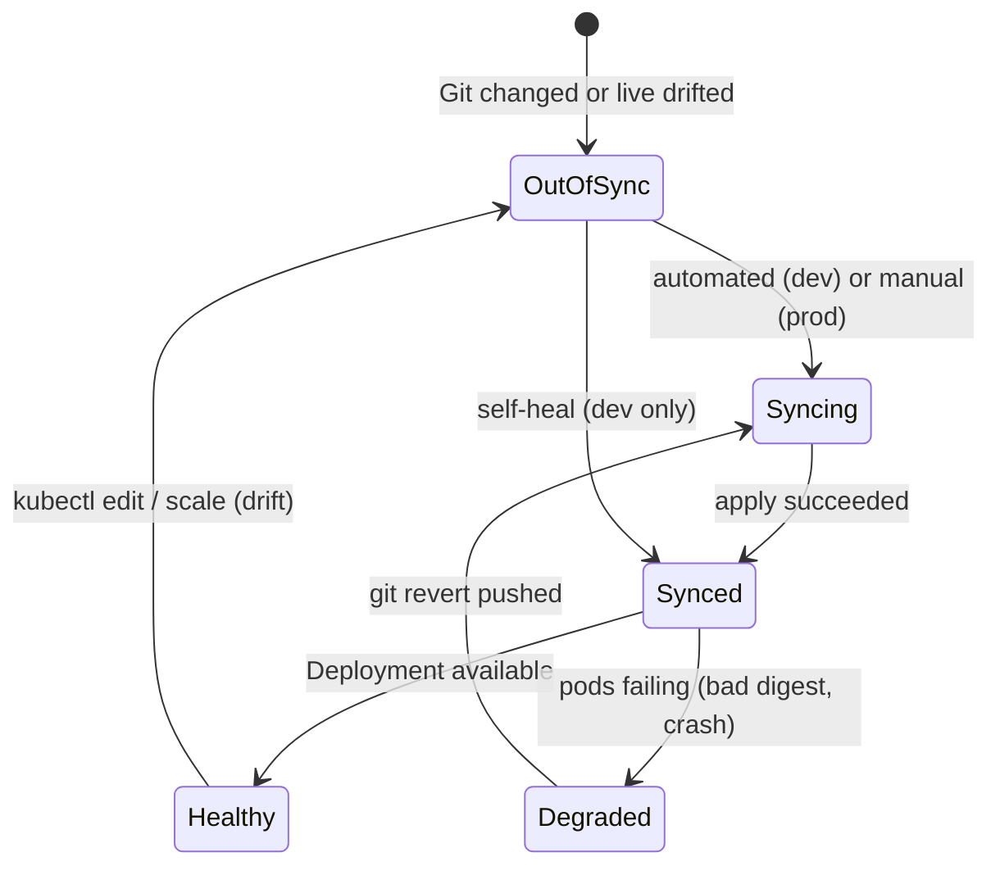

# AWS 09 — Helm and Argo CD GitOps

| | |
|---|---|
| **Project ID** | `aws-09` |
| **Cloud** | AWS (EKS from AWS 07) + Helm + Argo CD v3.6.1 + GitHub |
| **Difficulty** | Advanced |
| **Build time** | 4 h first attempt (on a running AWS 07 cluster) |
| **Rebuild time** | 15 min (plus AWS 07) |
| **Free tier** | **No**: runs on the billed AWS 07 cluster; Argo CD needs a third node (≈ +$0.02/h) — see [cost](docs/cost.md) |
| **Depends on** | [AWS 07](../07-managed-kubernetes-foundations/) (cluster, `node_count = 3`), [AWS 06](../06-secure-cicd-container-registry/) (image digests); [AWS 08](../08-kubernetes-networking-autoscaling/) only if you enable prod's Ingress |
| **Status** | Implemented · static checks passed (Terraform, Helm lint/template, manifests and Argo CD CRDs vs schemas, promotion script tested in a scratch worktree) · deployment **not tested** ([tracker](../../../docs/progress/implementation-tracker.md)) |

## The problem this lab solves

After AWS 07/08, deployments were `kubectl apply` runs from someone's laptop. Nothing recorded who changed
production or why, a hand edit could silently diverge from the manifests, rolling back meant remembering
the old command, and every deployer needed cluster-admin credentials.

This lab packages Taskboard as a **Helm chart** with a values schema that only accepts digests, and hands
deployment to **Argo CD**: Terraform installs Argo CD and one root Application, and from then on Git is the
only way to change what runs. An ApplicationSet creates **dev** (auto-sync, prune, self-heal) and **prod**
(manual sync) from per-environment values files; promotion is a commit that changes a digest; rollback is
`git revert`; drift is reverted in dev and reported in prod.

**Skills learned:** Helm charts, templates, helpers, values files, `values.schema.json`, `helm lint` /
`template` · Argo CD architecture (repo-server, application controller, ApplicationSet controller) ·
Applications, app-of-apps, ApplicationSets with `templatePatch`, multi-source values · AppProjects as guard
rails · sync, prune, self-heal, OutOfSync, health · promotion and rollback through Git · bootstrapping
GitOps with Terraform without chicken-and-egg CRD problems.

**Expected outcome:** `scripts/verify.sh` passes — Argo CD healthy with a minimal footprint, `gitops-root`
Synced/Healthy, both environments generated, dev running the digest committed in Git inside a `restricted`
namespace created by Argo CD, the AppProject limited to your repository and two namespaces, drift reverted
in dev, and prod waiting for a human.

## Architecture



| Component | Why it is there | Defined in |
|---|---|---|
| Taskboard chart | Deployment, Service, ConfigMap, HPA, PDB, Ingress, NetworkPolicies; schema rejects tags and `0.0.0.0/0` | [shared/helm-charts/taskboard](../../../shared/helm-charts/taskboard/) |
| Argo CD (Helm) | Minimal install: no Dex, no notifications, small requests, `server.insecure` behind port-forward | [argocd.tf](terraform/argocd.tf) |
| Root Application (argocd-apps chart) | The only Argo CD object Terraform creates; avoids CRD-at-plan-time problems | [argocd.tf](terraform/argocd.tf) |
| gitops-root chart | AppProject + ApplicationSet, parameterised by your repository URL | [gitops/root](gitops/root/) |
| ApplicationSet | `list` generator; `templatePatch` adds automated sync only for dev; multi-source `$values` | [applicationset.yaml](gitops/root/templates/applicationset.yaml) |
| Environment values | What runs where: digest, version, scaling, PDB, ingress | [environments/](environments/) |
| Promotion / sync scripts | Promotion = commit; prod sync = explicit, after reviewing the diff | [scripts/](scripts/) |

### Promotion flow



### Application states



## Concepts used

| Concept | Where in this lab | Guide |
|---|---|---|
| Helm, Argo CD, ApplicationSet, AppProject, sync and drift | Whole lab | [helm-and-gitops](../../../docs/concepts/helm-and-gitops.md) |
| Digests, provenance | Values files, promotion | [cicd-supply-chain-security](../../../docs/concepts/cicd-supply-chain-security.md) |
| HPA, PDB, NetworkPolicy, rollouts | Chart templates | [kubernetes-traffic-and-scaling](../../../docs/concepts/kubernetes-traffic-and-scaling.md) |
| Pod Security, RBAC | Namespaces created by Argo CD | [kubernetes-core-concepts](../../../docs/concepts/kubernetes-core-concepts.md) |
| Remote state | Bootstrap stack | [terraform-state-and-locking](../../../docs/concepts/terraform-state-and-locking.md) |

Architecture decisions: [ADR-0001 Argo CD bootstrapped by Terraform, app of apps](docs/adr/0001-argocd-terraform-bootstrap-app-of-apps.md) ·
[ADR-0002 shared Helm chart with per-environment values](docs/adr/0002-helm-chart-per-environment-values.md) ·
[ADR-0003 auto-sync dev, manual prod, promotion by commit](docs/adr/0003-promotion-by-commit-manual-prod.md).

## Deploy

### 1. Prerequisites

```bash
cd projects/aws/09-helm-argocd-gitops
kubectl get nodes        # AWS 07 cluster; apply AWS 07 with node_count = 3 for Argo CD's pods
gh repo view --json url  # your fork (public, so Argo CD can read it without credentials)
helm lint ../../../shared/helm-charts/taskboard -f environments/dev/values.yaml
```

### 2. Point dev at a real image, then bootstrap

```bash
scripts/promote.sh dev                                   # newest AWS 06 digest → commit → push
cp terraform/terraform.tfvars.example terraform/terraform.tfvars   # repo_url = your fork
../../../shared/scripts/tf-init-backend.sh terraform
terraform -chdir=terraform plan -out=lab09.tfplan        # 2 helm releases
terraform -chdir=terraform apply lab09.tfplan            # ≈ 3-5 minutes
```

### 3. Open Argo CD

```bash
$(terraform -chdir=terraform output -raw admin_password_command)
kubectl -n argocd port-forward svc/argocd-server 8080:80     # http://localhost:8080, user admin
kubectl -n argocd get applications
```

### 4. Verify, then promote to prod

```bash
scripts/verify.sh
scripts/promote.sh prod --from dev
scripts/sync-prod.sh
```

| Check | Expected |
|---|---|
| Argo CD pods | all ready, no Dex |
| gitops-root | Synced / Healthy |
| Generated apps | `taskboard-dev`, `taskboard-prod` |
| AppProject | destinations `taskboard-dev taskboard-prod`; one source repo |
| dev | Synced / Healthy; running digest = digest in `environments/dev/values.yaml`; namespace PSA `restricted` |
| Self-heal | manual scale to 3 reverted to 1 |
| prod | no automated sync; OutOfSync until `sync-prod.sh` |

### 5. Exercises and drills

[docs/exercises.md](docs/exercises.md) and `scripts/failure-drill.sh list` (drift, delete, bad-release,
rollback).

### 6. Clean up

```bash
kubectl -n argocd delete applicationset taskboard          # Argo CD removes both environments
kubectl -n argocd delete application gitops-root
terraform -chdir=terraform destroy                         # removes Argo CD
kubectl delete namespace taskboard-dev taskboard-prod --ignore-not-found
# then AWS 08 / AWS 07 cleanup
```

Delete Applications before Argo CD itself: Argo CD's finalizers remove what it deployed; if Argo CD is gone
first, the namespaces (and any ALB from prod's Ingress) stay behind.

## Troubleshooting, cost and interview material

- [Troubleshooting playbook](docs/troubleshooting.md) — 7 incidents
- [Cost estimate](docs/cost.md)
- [Interview preparation](docs/interview.md) — 7 questions

## Repeat practice

| Attempt | Goal | Guidance |
|---|---|---|
| 1 | Guided build | Follow this README and the exercises |
| 2 | Reduced guidance | Rebuild using only the promotion-flow diagram; predict each application's status before you look |
| 3 | Rebuild from objectives | Add a `staging` environment (values file + one list element) without touching anything else |
| 4 | Failure drills | Someone runs a drill or pushes a bad values change; restore service only through Git |
| 5 | Defend the design | Answer the [interview questions](docs/interview.md); argue push-based CD (`helm upgrade` from CI) and lose |

### Self-assessment

- [ ] I can explain every Argo CD component and which one talks to Git.
- [ ] I can explain why Terraform creates only the root Application.
- [ ] I can explain why dev reverts my `kubectl scale` and prod does not.
- [ ] I promoted a digest to prod and can point to the commit that did it.
- [ ] I rolled back a bad release with `git revert` and nothing else.
- [ ] I can explain what the AppProject prevents.

**Done when:** `verify.sh` passes, a promotion reached prod through a commit and a manual sync, the
bad-release drill was fixed with a revert, the self-assessment is complete, and cleanup removed both
environments and Argo CD.

## References

- [Argo CD documentation](https://argo-cd.readthedocs.io/en/stable/)
- [argo-helm charts](https://github.com/argoproj/argo-helm)
- [Helm chart template guide](https://helm.sh/docs/chart_template_guide/)
- [Terraform Helm provider](https://registry.terraform.io/providers/hashicorp/helm/latest/docs)
