# AWS 09 — Hands-on exercises

Run from `projects/aws/09-helm-argocd-gitops` with the Argo CD UI open
(`kubectl -n argocd port-forward svc/argocd-server 8080:80`). Shortcuts:

```bash
CHART=../../../shared/helm-charts/taskboard
apps() { kubectl -n argocd get applications -o custom-columns=NAME:.metadata.name,SYNC:.status.sync.status,HEALTH:.status.health.status,REV:.status.sync.revision; }
```



```mermaid
flowchart LR
    e1[1 Read the chart]:::app --> e2[2 Schema as a gate]:::sec --> e3[3 Argo CD internals]:::k8s --> e4[4 Promote dev]:::app
    e4 --> e5[5 Drift & self-heal]:::risk --> e6[6 Promote prod]:::sec --> e7[7 Bad release & revert]:::risk --> e8[8 Add staging]:::data
    classDef app fill:#dcfce7,stroke:#15803d,color:#14532d
    classDef sec fill:#ffedd5,stroke:#c2410c,color:#7c2d12
    classDef k8s fill:#ede9fe,stroke:#6d28d9,color:#4c1d95
    classDef risk fill:#fee2e2,stroke:#b91c1c,color:#7f1d1d
    classDef data fill:#fef9c3,stroke:#a16207,color:#713f12
```

## 1. Read the chart as Argo CD will

```bash
helm template taskboard $CHART -n taskboard-dev  -f environments/dev/values.yaml  | grep -E '^kind:|replicas:|image:'
helm template taskboard $CHART -n taskboard-prod -f environments/prod/values.yaml | grep -E '^kind:|replicas:|image:'
diff <(helm template taskboard $CHART -f environments/dev/values.yaml) <(helm template taskboard $CHART -f environments/prod/values.yaml)
```

**Expected:** dev renders a Deployment with `replicas: 1`, no HPA, no PDB; prod renders no `replicas`
field, an HPA (2–4) and a PDB. Explain why the template omits `replicas` when autoscaling is on (AWS 08's
lesson, now encoded in the chart).

## 2. The schema is a deployment gate

```bash
helm template t $CHART --set image.repository=r --set image.digest=v1.2.3
helm template t $CHART -f environments/prod/values.yaml --set ingress.enabled=true --set ingress.inboundCidrs=0.0.0.0/0
helm template t $CHART
```

**Expected:** the first two fail on `values.schema.json` (tag instead of digest; open CIDR); the third fails
on `required` (no image). Argo CD runs the same rendering, so a bad values commit becomes a visible
`ComparisonError` instead of a broken deployment. Name one rule you would add to the schema.

## 3. Argo CD's moving parts

```bash
kubectl -n argocd get pods
kubectl -n argocd logs deploy/argocd-repo-server --tail 20 | grep -iE 'helm|git'
kubectl -n argocd get applicationset taskboard -o jsonpath='{.status.conditions}' | jq
kubectl -n argocd get application taskboard-dev -o jsonpath='{.spec.sources}' | jq
```

**Expected:** five workloads (server, repo-server, application-controller, applicationset-controller,
redis). The repo-server clones and renders; the controller diffs and applies; the ApplicationSet controller
generated two Applications whose `sources` show the chart path and the `$values` ref. Explain which
component would need credentials for a private repository.

## 4. Promote to dev

```bash
scripts/promote.sh dev           # newest AWS 06 image
watch -n 5 apps                   # within ~60 s dev picks up the new revision
kubectl -n taskboard-dev get pods -o jsonpath='{.items[*].spec.containers[0].image}'; echo
git log --oneline -n 3 -- environments/
```

**Expected:** a commit, then dev Syncing → Synced/Healthy with the new digest. The Git log *is* the
deployment log. Answer: what would the AWS 06 pipeline need to do to promote automatically (commit to this
file — with which credentials, and why not cluster credentials)?

## 5. Drift and self-heal

```bash
scripts/failure-drill.sh drift
watch -n 5 apps
kubectl -n taskboard-dev get deploy taskboard -o jsonpath='{.spec.template.spec.containers[0].env}'; echo
```

**Expected:** dev briefly shows OutOfSync and is reverted (self-heal); prod (if synced before) stays
OutOfSync and shows the diff in the UI. Then run `scripts/failure-drill.sh delete`: the dev Deployment comes
back by itself. Explain when self-heal is dangerous (during an incident when someone needs to scale by hand).

## 6. Promote to prod with a gate

```bash
scripts/promote.sh prod --from dev
apps                                   # taskboard-prod OutOfSync, nothing applied
scripts/sync-prod.sh                   # review the listed resources, then confirm
kubectl -n taskboard-prod get hpa,pdb,pods
```

**Expected:** prod changes only after the explicit sync; HPA and PDB exist. Discuss: is "manual sync" a
real control if anyone with Argo CD access can click Sync? (Argo CD RBAC, sync windows, PR reviews on the
values file are the stronger controls.)

## 7. Bad release, fixed only through Git

```bash
scripts/failure-drill.sh bad-release    # digest that does not exist → dev
watch -n 5 apps                          # dev Synced but Degraded
kubectl -n taskboard-dev get pods        # new pod ImagePullBackOff; old pod still serving (maxUnavailable 0)
scripts/failure-drill.sh rollback        # git revert + push
```

**Expected:** dev turns Degraded but keeps serving from the old ReplicaSet — the rolling update never
removed it. The revert restores Healthy within a minute. Explain why the fix is a commit and not
`kubectl rollout undo` (self-heal would undo your undo).

## 8. Add a staging environment

Add `- name: staging` / `autoSync: false` to `gitops/root/values.yaml`, create
`environments/staging/values.yaml` (copy prod, `maxReplicas: 2`), commit and push.

**Expected:** the ApplicationSet generates `taskboard-staging`, but its sync fails with a permission error:
the AppProject's destinations do not include `taskboard-staging` — until the AppProject template's loop
picks it up from the same values list (it does, after the root app syncs). Explain the order of events, then
remove staging again via Git and watch prune delete it.
