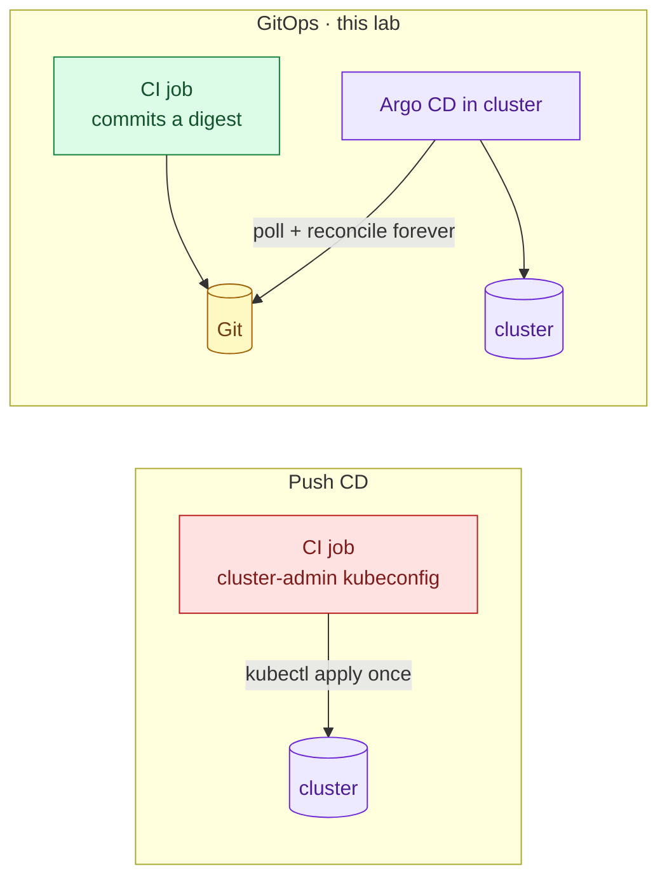
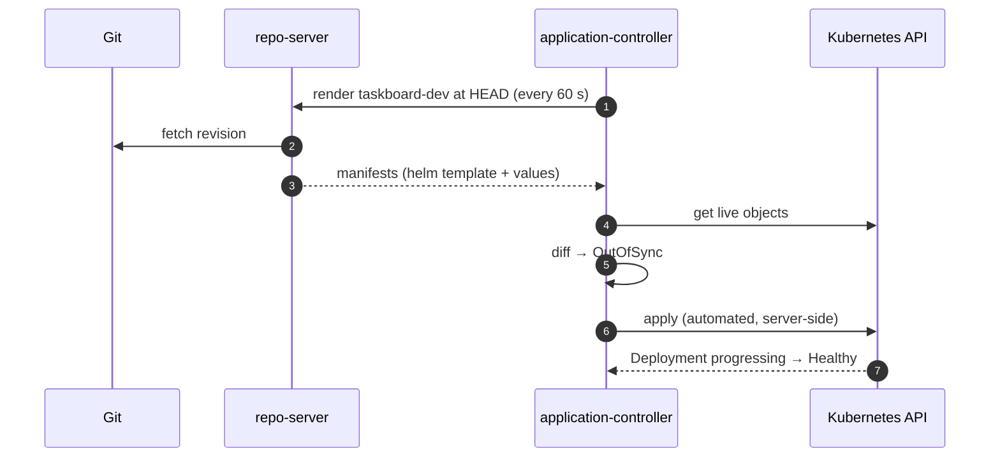
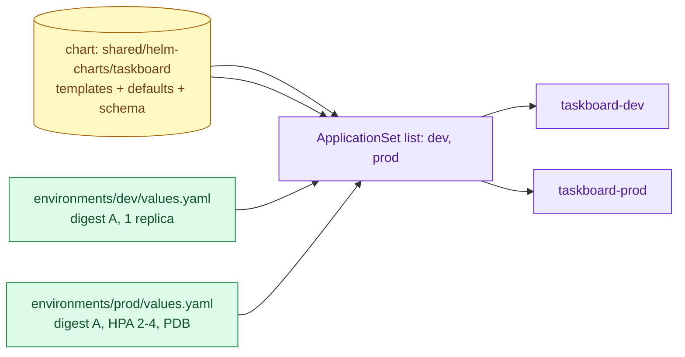
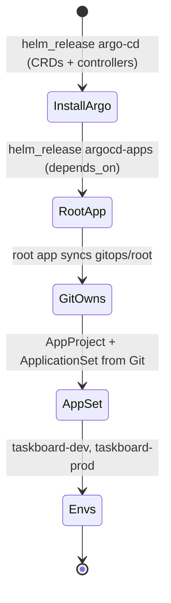
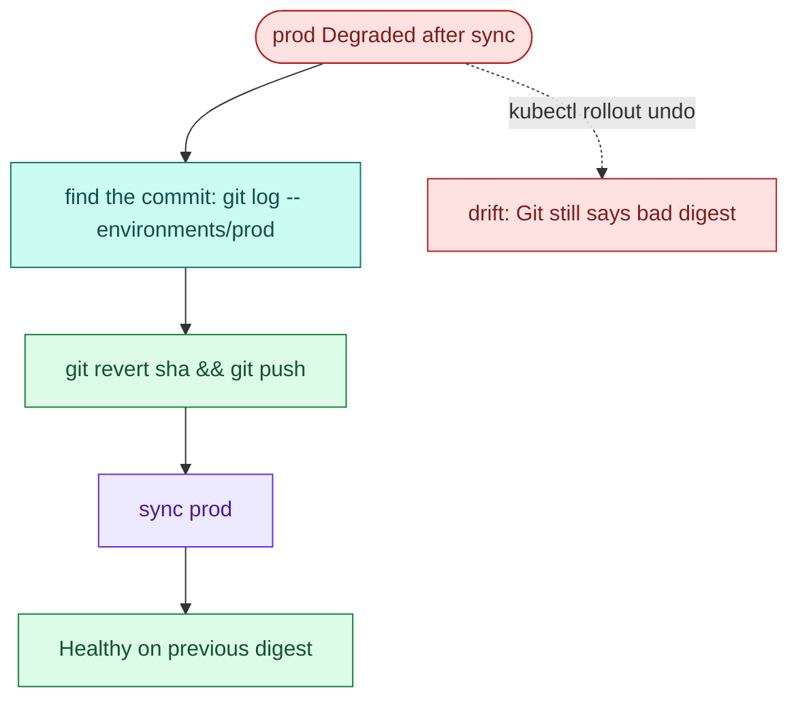
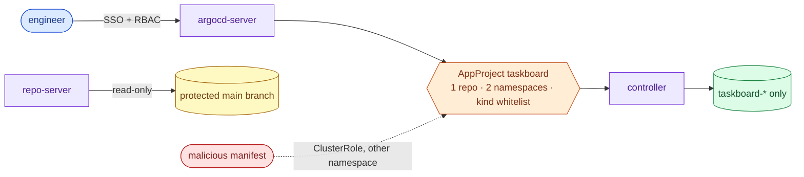
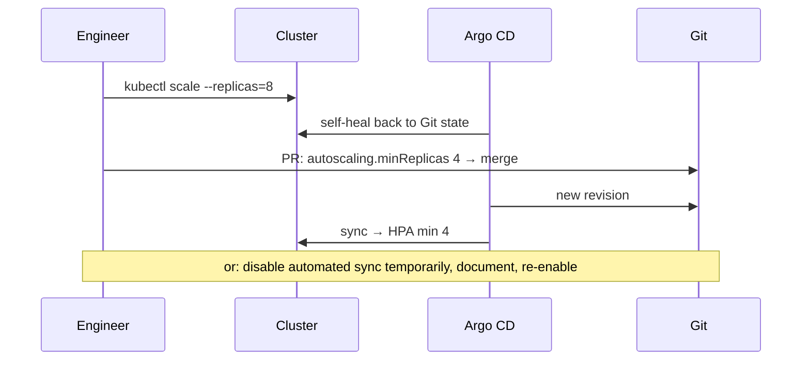

# AWS 09 — Interview preparation

Index of all questions: [interview index](../../../../docs/interview-preparation/README.md).

---

## Q1 (Beginner) — What is GitOps, and how is it different from a CI pipeline running `kubectl apply`?

**Interview answer:** GitOps makes Git the single source of truth for desired state, and an agent inside
the cluster continuously pulls and reconciles it. A CI pipeline that runs `kubectl apply` pushes changes
once and then forgets: it needs cluster credentials, cannot see drift, and the cluster's state is whatever
the last run left. With GitOps, deploys and rollbacks are commits, drift is detected (or reverted), and CI
never touches the cluster.

**Walkthrough:** credentials flip direction — the cluster reads Git; nothing outside writes to the cluster.

**Follow-ups:** What are the four OpenGitOps principles? What do you lose (speed of hotfixes, need for
discipline about manual changes)?

---

## Q2 (Intermediate) — Explain Argo CD's architecture. What happens between a commit and running pods?

**Interview answer:** The repo-server clones the repository and renders manifests (here Helm with the
environment's values); the application controller compares rendered and live state, marks the Application
OutOfSync, and — if automated — applies the difference through the Kubernetes API, then tracks health. The
ApplicationSet controller generates Applications from templates; the API server and UI expose all of it.

**Walkthrough:** only the repo-server talks to Git; only the controller writes to the cluster — they need
different credentials and can be secured separately.

**Follow-ups:** How does Argo CD decide health for a custom resource? Why is the controller a StatefulSet
(sharding)?

---

## Q3 (Intermediate) — How do you manage multiple environments with one Helm chart?

**Interview answer:** One chart with sensible defaults, and a small values file per environment containing
only what differs — image digest, replicas or autoscaling, PDB, ingress. An ApplicationSet (or one
Application per environment) points the same chart at each values file and namespace. Promotion copies a
digest from one environment's file to the next in a commit. The chart's JSON schema rejects invalid values
before anything renders.

**Tradeoffs:** Kustomize overlays (AWS 07/08) patch plain YAML and avoid templating logic; Helm adds
packaging, versioning and schemas but templates can become unreadable. Many teams use both.

**Follow-ups:** Where would you keep secrets? How do you test a chart (lint, template + kubeconform,
helm-unittest)?

---

## Q4 (Advanced) — How do you bootstrap Argo CD with Terraform without a chicken-and-egg problem?

**Interview answer:** Terraform installs Argo CD and creates exactly one root Application, then stops. The
root Application points at a Git path containing everything else (projects, ApplicationSets, add-ons), so
Argo CD manages its own configuration from then on. The catch is that the Application CRD does not exist
until Argo CD is installed, so planning a `kubernetes_manifest` for it in the same apply fails; creating
the root app through a second Helm release (the `argocd-apps` chart) avoids planning against a missing CRD.

**Walkthrough:** after bootstrap, Terraform never changes Argo CD Applications; adding an environment is a
Git change (exercise 8).

**Follow-ups:** Should Argo CD manage itself (upgrades via Git)? How do you bootstrap many clusters
(ApplicationSet cluster generator)?

---

## Q5 (Scenario) — A bad release reached production through GitOps. How do you roll back, and what must you not do?

**Interview answer:** Revert the commit that changed the production values (or promote the previous
digest) and sync. Do not `kubectl rollout undo` or edit the Deployment: with self-heal Argo CD reverts your
fix; without it, Git and the cluster now disagree and the next sync redeploys the bad version. Because the
rollout used `maxUnavailable: 0`, old pods may still be serving if the new ones never became Ready.

**Walkthrough:** exercise 7 rehearses it in dev with the bad-release drill.

**Follow-ups:** How would progressive delivery (Argo Rollouts canary with analysis) catch this earlier? How
fast can GitOps roll back compared with a push pipeline?

---

## Q6 (Advanced) — How do you secure Argo CD itself?

**Interview answer:** It is a cluster-admin-capable component, so: minimise who can use it (SSO + RBAC,
disable or rotate the local admin), restrict what each AppProject may deploy (source repos, destination
namespaces, resource kinds — no cluster-scoped kinds except what is needed), keep the UI private, use
read-only repository credentials, sign or protect the branches it tracks, and keep secrets out of Git.

**Walkthrough:** the lab's AppProject would reject a manifest that adds a ClusterRole or targets
`kube-system`, even if it reaches Git.

**Follow-ups:** How do you handle secrets in GitOps (External Secrets Operator, Sealed Secrets, SOPS)? Who
can merge to the tracked branch, and why does that matter more than Argo CD RBAC?

---

## Q7 (Scenario) — During an incident, an engineer scales the prod Deployment by hand and Argo CD keeps putting it back. What is the right process?

**Interview answer:** Self-heal is doing its job: Git says otherwise. Either make the change in Git (fast
PR to raise `minReplicas`), or deliberately pause reconciliation for that Application — disable automated
sync or use a sync window — make the manual change, and record a follow-up to reconcile Git. Afterwards,
fix the root cause (here the HPA should have scaled; why didn't it?).

**Walkthrough:** in this lab prod is manual, so the hand change would persist but show OutOfSync — the
diff is the reminder to fix Git.

**Follow-ups:** What are sync windows? Should prod be auto-synced at all?
