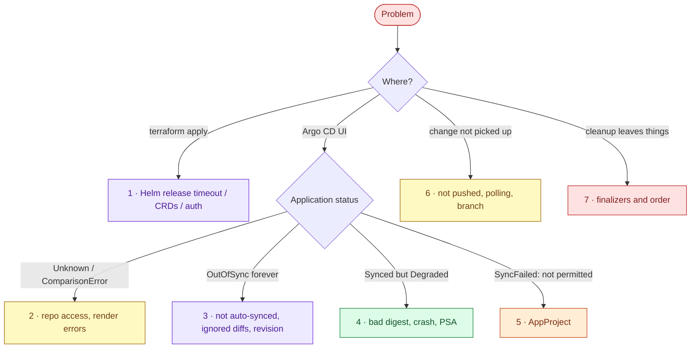

# AWS 09 — Troubleshooting playbook



## 1. `terraform apply` times out on `helm_release.argocd`

**Symptoms:** `context deadline exceeded` after 10 minutes; pods Pending.

**Likely causes:** not enough pod capacity (t3.small: 11 pods per node; Argo CD adds 5); provider cannot
authenticate (`aws eks get-token` uses a principal without an access entry); chart download blocked.

**Diagnose:**

```bash
kubectl -n argocd get pods
kubectl -n argocd describe pod <pending-pod> | sed -n '/Events/,$p'
aws sts get-caller-identity; aws eks list-access-entries --cluster-name lab07-eks
```

**Resolve:** apply AWS 07 with `node_count = 3`; use the admin principal; re-run apply (Helm resumes).

**Prevent:** capacity check in the README prerequisites.

## 2. Application shows `Unknown` / `ComparisonError`

**Symptoms:** no diff, error banner in the UI.

**Likely causes:** repository URL wrong or private (no credentials); `targetRevision` branch missing; Helm
render error — schema violation or `required` value (e.g. the placeholder digest is fine for rendering, a
tag is not); values file path wrong in the multi-source `$values` reference.

**Diagnose:**

```bash
kubectl -n argocd get application taskboard-dev -o jsonpath='{.status.conditions}' | jq
kubectl -n argocd logs deploy/argocd-repo-server --tail 40
helm template taskboard ../../../shared/helm-charts/taskboard -f environments/dev/values.yaml >/dev/null
```

**What the results mean:** `authentication required` / `repository not found` → access; `values don't meet
the specifications of the schema` → bad values commit; `no such file` → path.

**Resolve:** fix and push; for a private fork add a repository secret in `argocd`.

**Prevent:** `scripts/validate.sh helm` in CI renders every environment before merge.

## 3. Application stays `OutOfSync`

**Symptoms:** the diff never goes away.

**Likely causes:** prod is manual by design (run `sync-prod.sh`); a field mutated by a controller (HPA
changing replicas when the chart still renders `replicas`); auto-sync disabled after a failed sync; the
diff is on a field Argo CD should ignore.

**Diagnose:**

```bash
kubectl -n argocd get application taskboard-dev -o jsonpath='{.spec.syncPolicy}'; echo
kubectl -n argocd get application taskboard-dev -o json | jq '.status.resources[] | select(.status=="OutOfSync")'
```

**Resolve:** sync; remove the conflicting field from the chart (as done for `replicas`); or add
`ignoreDifferences` for genuinely controller-owned fields.

**Prevent:** never template fields another controller owns.

## 4. `Synced` but `Degraded`

**Symptoms:** Git applied, app unhealthy.

**Likely causes:** digest that does not exist or the initial placeholder (ImagePullBackOff); crash on start;
Pod Security rejecting a pod (`violates PodSecurity`) after a chart change; probes failing.

**Diagnose:**

```bash
kubectl -n taskboard-dev get pods
kubectl -n taskboard-dev describe pod <pod> | sed -n '/Events/,$p'
kubectl -n taskboard-dev get events --sort-by=.lastTimestamp | tail
```

**Resolve:** `scripts/failure-drill.sh rollback` (git revert), or promote a known-good digest.

**Prevent:** promote only digests that AWS 06 pushed and scanned; `maxUnavailable: 0` keeps the old version
serving meanwhile.

## 5. `SyncFailed: ... is not permitted in project taskboard`

**Symptoms:** sync error naming a resource kind or namespace.

**Likely causes:** the chart started rendering a kind not in `namespaceResourceWhitelist` (e.g. a
ServiceAccount); a new environment not yet in the AppProject destinations; a different repo URL.

**Diagnose:**

```bash
kubectl -n argocd get appproject taskboard -o yaml | sed -n '/spec:/,$p'
```

**Resolve:** add the kind or destination in `gitops/root/templates/appproject.yaml` via Git.

**Prevent:** this is the guard rail working; widen it deliberately, in review.

## 6. A pushed change is not deployed

**Symptoms:** Git shows the commit; Argo CD shows an older revision.

**Likely causes:** the commit is on another branch (`target_revision` is `main`); not pushed
(`promote.sh` asks); polling interval not elapsed (60 s); repo-server cache.

**Diagnose:**

```bash
git log origin/main --oneline -n 3 -- projects/aws/09-helm-argocd-gitops/environments
kubectl -n argocd get application taskboard-dev -o jsonpath='{.status.sync.revision}'; echo
```

**Resolve:** push to `main`; refresh: `kubectl -n argocd annotate application taskboard-dev argocd.argoproj.io/refresh=hard --overwrite`.

**Prevent:** a GitHub webhook to Argo CD in production (needs a reachable endpoint).

## 7. Cleanup left namespaces or an ALB behind

**Symptoms:** `taskboard-*` namespaces or `k8s-taskboar*` load balancers exist after `terraform destroy`.

**Likely causes:** Argo CD was destroyed before its Applications, so nothing ran the resource finalizers;
an Application without the finalizer was deleted (non-cascading).

**Diagnose:**

```bash
kubectl get ns | grep taskboard
kubectl -n argocd get applications -o jsonpath='{range .items[*]}{.metadata.name}{" "}{.metadata.finalizers}{"\n"}{end}'
../../../shared/scripts/aws-find-lab-resources.sh
```

**Resolve:** delete leftover namespaces; delete orphaned load balancers (AWS 08 playbook #7).

**Prevent:** README cleanup order: ApplicationSet → root Application → Terraform destroy.
