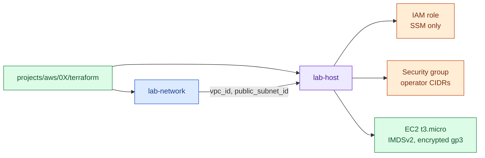

# Shared Terraform modules

Modules here are consumed by several projects through relative paths, so a fix lands everywhere at once.

| Module | Used by | What it creates | Free-tier notes |
|---|---|---|---|
| [aws/lab-network](aws/lab-network/) | AWS 01–03 | VPC, one public subnet, IGW, route table, locked default SG | No NAT Gateway (never free). No flow logs (billed). |
| [aws/lab-host](aws/lab-host/) | AWS 01–03 | Ubuntu 24.04 EC2, key pair, SG, SSM-only IAM role | Free-tier instance types only, `cpu_credits = "standard"`, root disk ≤ 30 GB, detailed monitoring off. |

Rules for changing a shared module:

1. Keep inputs backward compatible, or update every caller in the same change.
2. Run `scripts/validate.sh terraform` — it validates every project that consumes the module.
3. Do not add resources that are billed by default; make them opt-in variables.
